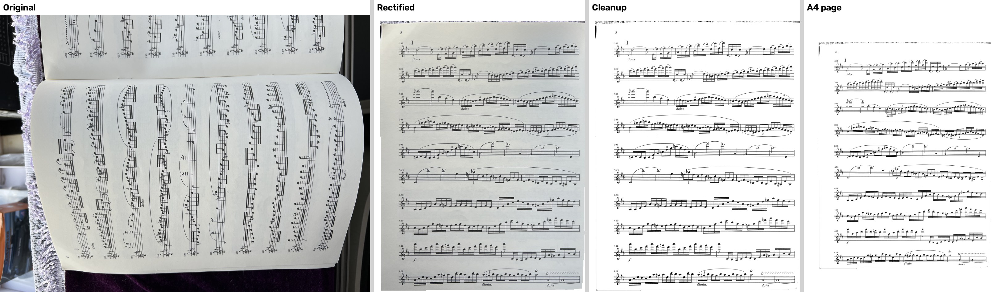
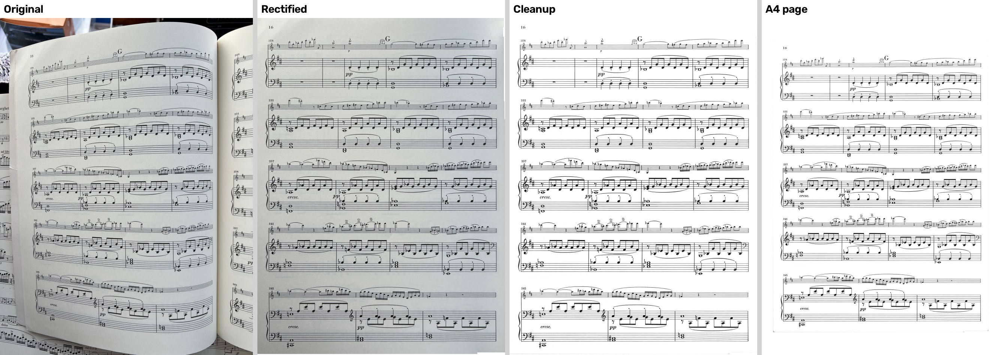
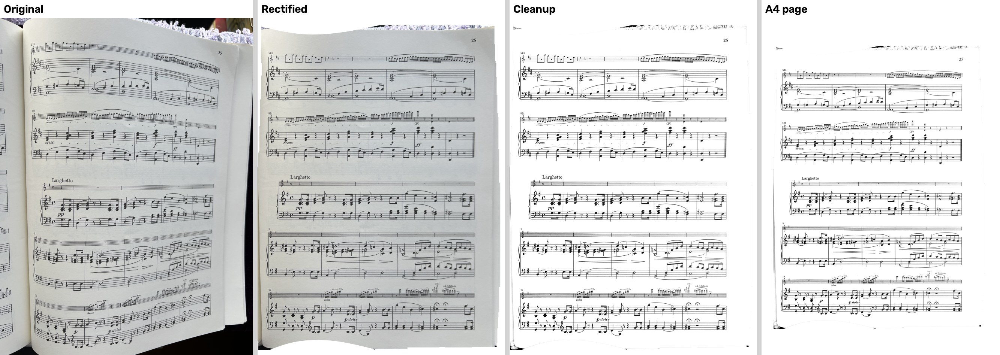
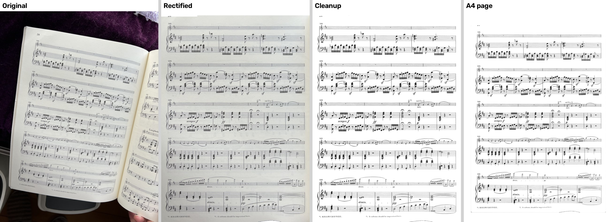

# score_dewarp — 乐谱照片平直化校正（五线谱 / 简谱 / 混排）

输入一张手机拍摄的乐谱照片（透视、卷曲、褶皱、阴影），输出：

- **校正后的彩色图**（`_rectified.png`）和**阅读副本**（`_enhanced.png`：去阴影、纸面置白、纸外置白；`--binary` 另存黑白版），分辨率与输入照片一致（见下）
- **谱种标签**：`staff` / `jianpu` / `mixed` / `unknown`
- **结构**：谱线折线（含线号）、简谱数字框（含 0–7 识别）、文字行框、版面区域（`_result.json`）
- **变换场**：输出像素 → 原图像素的 backward map（`_bmap.npy`）
- **可打印纸页**：默认 A4 竖版、300 DPI、至少 10 mm 白边，完整等比例居中排版；导出 `_page.png`（阅读版）、`_page_color.png`（彩色版）、`_page.pdf` 和 `_preview.jpg`。

不需要训练数据：页面形变由检测到的乐谱结构（谱线、简谱数字行、竖线、谱表端点）反求，全部是几何优化。可选接入两个现成的小检测模型（`--models page|all`：U²-Netp 纸张分割、homr 谱线分割），只负责检测，不参与求形变；在 dev 基准和真实照片上都优于无模型方案（见“可选：小检测模型”）。

## 效果展示

手持拍摄的摊开乐谱书（iPhone HEIC），`--models page --crop-content`。每张从左到右：原图、校正后彩色图、阅读副本（cleanup）、A4 可打印页。说明和单独的大图见 [demo/](demo/README.md)。

**IMG_3682**：横着拍的，自动转正



**IMG_3684**：小提琴 + 钢琴，同页两种谱表大小



**IMG_3685**：小提琴 + 钢琴



**IMG_3686**：小提琴 + 钢琴，带对面页



## 快速开始

```bash
cd score_dewarp
python3 -m venv .venv && .venv/bin/pip install -r requirements.txt

# 校正照片（可一次传多张）
.venv/bin/python scripts/dewarp.py my_score.jpg --out outputs/run --binary

# 推荐：加上小检测模型（纸张分割；all 再加 homr 谱线），见“可选：小检测模型”
.venv/bin/python scripts/dewarp.py my_score.jpg --out outputs/run --models page
```

输入支持 JPEG、PNG、WebP、BMP、TIFF、HEIC 和 HEIF，也会按照片的 EXIF 方向旋正。macOS 上 HEIC/HEIF 由系统的 `sips` 解码为临时无损 PNG 并验证文件可读，原照片不变；其他系统如 Pillow 无 HEIF 解码插件，需要先自行转换成 JPEG 或 PNG。

### 选择输出纸张

```bash
# 默认：A4 竖版，300 DPI，10 mm 白边，同时导出图片与单页 PDF
.venv/bin/python scripts/dewarp.py my_score.jpg --out outputs/a4

# A3 横版、15 mm 白边
.venv/bin/python scripts/dewarp.py my_score.jpg --paper a3 --orientation landscape --margin-mm 15

# 自定义纸张 190 × 260 mm；横竖方向由 --orientation 决定
.venv/bin/python scripts/dewarp.py my_score.jpg --paper custom --size-mm 190 260

# 自适应：保留矫正画布尺寸和已有白边，不强制标准纸型；仅导出图片
.venv/bin/python scripts/dewarp.py my_score.jpg --paper adaptive --no-pdf
```

`--paper` 支持 `a4`、`a3`、`letter`、`custom`、`adaptive`，`--dpi` 设置导出分辨率。标准纸型完整容纳矫正画布，不裁切、不分别拉伸横纵比例；画布比例与纸型不同时，部分边缘留白会大于设定值。横版改变纸张方向，不旋转谱面。A4 在 300 DPI 下为 2480 × 3508 像素；PDF 物理尺寸由像素与 DPI 决定，有不足一个像素的取整误差。放大不会增加原照片细节。

`_preview.jpg` 可直接查看排版效果；`_page.pdf` 默认使用阅读副本，一张照片对应一个 PDF。`--binary` 另外导出纸张尺寸的 `_page_binary.png`。纸页彩色版从原照片按最终纸张像素一次采样，阅读版再在该分辨率清理，避免把粗检测用的约 1600 像素图放大；照片本身不清晰时仍不能凭空补出细节。选择纸型只控制最终排版，不假定被拍摄的原纸也是该规格，也不修复上游的页面分离或严重褶皱问题。

**输出分辨率**：检测和拟合在约 1600 像素宽的工作画布上进行；最后把变换按"一个输出像素约对应一个照片像素"缩放（页面内容区局部尺度的中位数，`stages.output_scale`），再从原照片一次采样得到 `_rectified.png` / `_enhanced.png`，结构坐标同步缩放。例：3024 × 4032 的 CPMS 照片输出 3001 × 3970（旧版为 1591 × 2105）。透视使页面各处采样密度不同，离镜头近处略降采样、远处略升采样。`--output-res canvas` 保留旧的画布输出；基准测试固定用画布（几何指标经映射计算，与分辨率无关）。标准纸型导出仍按 `--dpi` 采样：A4 300 DPI 宽 2480 像素，低于 12 MP 照片的原生分辨率，需要保留全部细节时用 `--paper adaptive` 或提高 `--dpi`。

`_rectified.png`、`_enhanced.png`、`_debug.jpg`、`_bmap.npy` 和结构坐标对应同一张输出图。`_result.json` 的 `stages.document` 记录纸张大小、DPI、像素尺寸和 `rectified_to_document` 矩阵，供将结构坐标映射到纸页；`_bmap.npy` 不能直接当作 `_page.png` 的坐标场。

其他选项：`--models page|all` 接入小检测模型（默认 `off`）；横着拍的五线谱（谱表竖直）会自动转 90°，`--no-rotate` 关闭；`--no-field` 只用曲面模型、不跑残差场；`--crop-content` 只输出内容框；默认只保留主页面（见下），`--keep-surroundings` 保留对面页、纸边和背景；`--method traditional` 是旧 ABC 方案，仅作对照。单张 12 MP 照片约 10 秒（Apple Silicon，单进程），`--models page` 约多 5 秒，`all` 约多 9 秒。

**只保留主页面**（CLI 默认，`scoredewarp/core/mainpage.py`；`MetricConfig.main_page` 默认关，基准不受影响）：只裁输出，不改几何。在最终输出上以检测到的谱表 / 简谱行为主体块；主体块一侧隔着一条无结构穿过的竖缝、只占总长 ≤ 30% 的一列结构视为对面页切掉（两列平衡的版面不切）。主体块宽度内、上下各半个块高范围内的印刷团块（页码、标题、脚注、检测漏掉的谱表）扩大输出框，输出 = 外框 + 3% 白边。框内置白需要纸张掩码（`--models page` 的 U²-Netp，无模型时用亮度掩码）：纸张以外，以及主体块边缘以外明显比纸暗的大块（掩码漏进来的椅子、纸边外的暗带）；纸上的印刷团块（四周是纸色、不是实心暗物）一律不置白，且只置白从框边连进来的背景，页面内部的孤岛不动。

## 方法

```
照片 ─►（可选）纸张分割 ─► A 页面单应 + 纠斜 ─► 结构检测（纸面上）─► B 针孔相机 + 可展柱面拟合（按纸边选解）─► 重新检测 ─► C 残差场 ─► 输出范围 / 页边距 / 阅读副本
```

括号内为 `--models page|all` 时的步骤（先找纸、再找线），见“可选：小检测模型”。

- **A**（`core/page.py`）：检测页面四边形做透视矫正，再用投影轮廓纠斜；检测不到四边形时只纠斜。
- **结构检测**（`core/structures.py`）：游程统计估计线粗和线距，逐列跟踪谱线并聚成五线谱表；简谱按字高把连通域链接成行，用模板识别 0–7；竖线（小节线、符干）只取细的部分，去掉符头 / 符尾连接处，否则符干整体偏约 1°。
- **B**（`core/gcs.py`）：纸张弯曲但不拉伸，页面用一般柱面（可展曲面）表示，加针孔相机。未知量是相机位姿、母线方向、截面斜率曲线和每个结构的平面坐标；约束是重投影误差加各谱种的几何关系（见下表）。曲面是等距展开的，所以输出的比例是度量正确的，不需要再估计长宽比。
- **C**（`core/field.py`）：在 B 的输出上重新检测，解一个网格上的前向场 `(U, V)`。所有先验都写成关于 U 或 V 的线性约束，加平滑项，用 IRLS 求稀疏最小二乘，全局比例不变（`keep_scale`）：
  - 纵向：同一谱线 V 相等、相邻谱线差一个线距；简谱行顶线、底线各自相等。
  - 竖直：竖线（小节线、符干、竖笔画）U 相等。
  - 横向尺子（`h_ruler=glyph`，2026-11-19 起）：沿谱线 / 简谱行的长度按局部符号宽度换算。同一页的实心符头、同一个简谱数字是同一个字形，平整时宽度处处相等（`structures.find_noteheads`：圆盘开运算留下符头）。此前用纵向线距代替，只在横向发生的压缩（书脊卷曲的主要形态）看不见。
  - 内容块两侧是直线（`block_jp`、`edge_w`，2026-11-19 起）：各行谱表的左右端点、简谱行的终止小节线 U 相等，行与行之间连线上的点也相等，使整条边在输出中是一条竖直直线，而不只是端点对齐。
- **输出**（`core/metric_pipeline.py`）：纸张边缘（GrabCut 掩码 + 纸面直线检验）限定范围，范围再扩到装下所有印刷内容，四周补 3% 白边；阅读副本只保留纸面。各阶段都表示成 `BackwardMap`，只对原图重采样一次。

| | 五线谱 | 简谱 |
|---|---|---|
| 主要线索 | 贯穿全宽、5 线等距的长细线；小节线、符干；谱表左右端对齐 | 没有长线：数字 0–7 字高一致（顶线 + 底线双约束）；小节线、数字和汉字的竖笔画 |
| B 中的先验 | 每个谱表一组 `Y0, s`：第 i 线 `Y = Y0 + i·s`，各谱表的 `s` 软约束一致；各行谱表的左右端共用一个 X | 每行一组 `Y_top, h`：数字顶点在 `Y_top`、底点在 `Y_top + h`；各行 `h` 软约束一致 |
| C 中的先验 | V：沿线相等、相邻线差 = 线距；U：沿线弧长按局部符头宽度归一；谱表左右端连成竖直直线 | V：顶线、底线各自相等，底 − 顶 = 字高；U：相邻字间距按同类数字宽度归一（权重 3）；行尾终止小节线连成竖直直线（各行首字本身不对齐，左边不约束） |

混排页面上两类约束同时作用于同一个曲面和残差场。

**同页多种谱表大小**（2026-11-19）：小提琴 + 钢琴谱、ossia 等页面上，小谱表线距只有主谱表的 0.55–0.7 倍。B 先在照片上把谱表线距排序，相邻比值超过 1.3 处分为不同大小类（`structures.spacing_classes`；同一字号因透视的差异约在 1.2 以内）；表中“各谱表的 `s` 软约束一致”只在同一类内成立。B 分出多类时，C 的线距参考和符头宽度尺子也按类取。只在 B 阶段（照片上）判断：B 输出上同一字号的谱表可能因残余拉伸呈现两档线距，那正需要 C 拉回（dev 0091 等）。此前全页单一线距把小提琴谱拉到钢琴谱的大小，手持照片 IMG_3684 整页扭曲；dev 120 页主线逐页不变，`--models page` 1 页变好。

### 可选：小检测模型（`--models page|all`，默认关闭）

```bash
.venv/bin/python scripts/dewarp.py my_score.jpg --models page   # 纸张分割
.venv/bin/python scripts/dewarp.py my_score.jpg --models all    # 纸张分割 + homr 谱线
```

做法与扫描类 App、RDGR 一致：小模型负责找纸和找线，几何负责求解。权重都随仓库提供（`models/`）。

- **纸张分割**（`core/pagenet.py`，U²-Netp，4.6 MB，Apache-2.0，通用显著性数据训练）有三个用途：
  - 检测只取纸面上的证据，背景的木纹、布褶不再变成伪谱线、伪竖线；
  - 亮度法找不到纸张四边形时，补一个模型四边形，四边须有纸 / 背景的灰度台阶；
  - B 的两个母线方向起点都优化完成后，选纸边在展平页上最接近矩形的解。

  纸张掩码有门控：须为实心、页面大小、并包含已检测到的谱面。整幅纸面特写（CPMS）上显著性网络会把谱表当前景，门控会拒绝，结果与无模型相同。纸面上的印刷都算输出内容。输出范围在曲面折叠处停止（`extent_fold`，不需要模型）。
- **homr 谱线**（`all`）：逐谱表与传统检测融合，只用网络谱线，符干仍用传统（网络符干无偏但噪声更大，会使竖线倾角变差）。

| dev 120 页 | AD 中位 / 均值 / p90 / 最大 | LD 均值 | 谱线平直 均值 | 竖线倾角 均值 | CPMS 符头准确率（传统 / homr 裁判） |
|---|---:|---:|---:|---:|---:|
| 无模型 | 0.875 / 1.048 / 1.939 / 3.89 | 8.83 | 0.311 | 1.10° | 0.757 / 0.879 |
| `--models page` | **0.796 / 0.950 / 1.646 / 3.64** | **8.23** | **0.250** | 0.97° | 0.756 / 0.878 |
| `--models all` | 0.817 / 0.985 / 1.760 / 4.15 | 8.41 | 0.268 | **0.95°** | **0.763 / 0.890** |

手持拍书照片 13 张目视：主页面 7 张更好、6 张持平、0 张更差。代价：每张约多 5–9 s。退化页（重度卷曲上 B 落到较差解）、对页问题和完整对照见 [模型路线报告](reports/model_route_20261119.md)。

### 旧接入方式：`--seg homr`（已由 `--models all` 取代，保留作对照）

采用学习检测与几何优化分工的思路（如 RDGR 的边界 / 文本行检测 + 网格优化），接入了开源 OMR 项目 [homr](https://github.com/liebharc/homr) 的五线谱分割网络（UNet，DeepScoresV2 训练，ONNX，57 MB；输出谱线、符干 / 小节线、符头、谱号、其他符号）。PaddleOCR 的 UVDoc 文档展平模块属于另一种实现，不能直接视为这种检测 + 独立几何优化架构的例子。

```bash
.venv/bin/python scripts/dewarp.py my_score.jpg --seg homr
```

权重随仓库提供（`models/homr/`，57 MB，来源与许可见其 `NOTICE.md`），依赖 `onnxruntime`（已在 `requirements.txt` 中）。缺失时可用 `scripts/download_models.py` 从 homr 的发布页重新下载。

- **推理**（`core/learned.py`）：自写滑窗推理，复现 homr 的预处理（灰度 + CLAHE、320 px 窗口、半窗步长）；输入宽度按实测线距缩放到约 16 px / 线距（homr 固定宽 1920，在低分辨率照片上会整排漏检谱表）。macOS 上用 CoreML，约 2–5 s / 页；`SCOREDEWARP_SEG_CACHE` 可缓存结果。分割图在照片上算一次，随图像用同一个 `BackwardMap` 重采样，每轮重新检测都复用。
- **融合**（`structures.py`）：谱表取网络谱线掩码与形态学检测中覆盖谱线总长更长的一方；谱表区内的竖笔画取网络的符干 / 小节线（不含符头，从源头去掉符干约 1° 的偏斜），并把谱线像素补回（网络类别互斥，符干在每条谱线处被切断）；网络找不到谱表时（简谱页）完全走原流程，结果逐像素不变。
- **效果**：检测指标明显改善，但未显示稳定的端到端展平收益，且有少数严重退化页，因此未设为默认：

| 评测 | 手工检测 | + homr |
|---|---:|---:|
| dev 16 页，谱线召回 / 位置误差（线距） | 0.875 / 0.031 | **0.917 / 0.029** |
| dev 16 页，竖笔画偏斜 | −0.64° | **−0.51°** |
| dev 120 页端到端，内容区 AD 中位（页宽 %） | 0.875 | 0.875（28 页好 / 22 页差） |
| CPMS 60 张照片，照片上检测：符头音高位置准确率 | 0.726 | **0.868**（50 张好 / 2 张差） |
| CPMS 端到端：同一裁判读校正结果的符头位置准确率 | 0.879 | 0.873 |
| CPMS 端到端：校正后谱线残余弯曲（线距）/ 倾斜 | 0.020 / 0.04° | **0.016 / 0.02°** |

上述 dev AD 中位数没有反映尾部：homr 的 AD 均值为 1.118（默认 1.048），最大值 9.636（默认 3.887）。[检测接入独立消融](reports/detection_route_20261118.md)重新运行了六组、每组 120 页：补回符干单独消融缺失的谱线交叉处后，AD 中位 1.046 → 0.887，但仍未稳定优于默认；按行端点、端点权重为零也有退化。局部映射检查的离线回退能拦住部分异常，另有大量候选的检查状态未解决，尚未接入默认流程。另检查了三张平整页和固定随机 12 张 CPMS；完整参数、逐页数据和对比图见报告。

CPMS 上同一张校正图，手工检测器读出的符头位置准确率为 0.76，网络读出 0.88：网络的价值主要在输出结构（谱线、音高位置，便于 OMR），而非形变求解。homr 的代码和权重均为 AGPL-3.0（训练数据 DeepScoresV2 为 CC BY 4.0）；本仓库是个人非商用 demo，原样附带该权重。

## 评测

基准用 Doc3D 的真实纸张形变（UV 图）给乐谱页重新贴图（`data/bench/doc3d_score`，dev / test 各 120 页，五线谱、简谱、混排，轻 / 中 / 重三档），所有指标都来自真值，不经过我们的检测器。

```bash
.venv/bin/python scripts/download_datasets.py deepscores   # 以及 doc3d；CPMS 真实照片用 download_cpms.py
.venv/bin/python scripts/make_doc3d_bench.py --out data/bench/doc3d_score --per-split 120
.venv/bin/python scripts/bench.py --data data/bench/doc3d_score/dev --methods input abc metric --out outputs/bench/dev
.venv/bin/python scripts/bench.py --data data/bench/doc3d_score/dev --methods metric "gcs:c.ends_w=4" --out outputs/bench/x   # 参数变体
.venv/bin/python scripts/make_compare_figures.py --out reports/compare_xxx                                                  # 对比图
```

dev 中位数（当前指标定义；主线与模型两列为 2026-11-19 同一次运行 `outputs/bench/final_models_20261119`）：

| 指标 | 原图 | 旧 ABC | 主线（无模型） | `--models page` | `--models all` |
|---|---:|---:|---:|---:|---:|
| 内容区 AD（页宽 %） | 2.44 | 1.77 | 0.875 | **0.796** | 0.817 |
| 内容区 LD（局部畸变 %） | 13.7 | 11.9 | 6.92 | 6.65 | **6.50** |
| 可见页面保留比例 | 1.000 | 0.881 | 0.998 | 0.997 | 0.998 |
| 谱线平直度（y 标准差 / 线距） | 1.30 | 0.71 | 0.149 | **0.141** | 0.142 |
| 竖线倾角（°） | 2.74 | 2.50 | 0.753 | **0.687** | 0.704 |
| 简谱基线平直度（/ 字高） | 0.51 | 0.24 | 0.084 | **0.071** | 0.077 |
| 页边倾斜（°） | 2.26 | 1.95 | 0.541 | 0.502 | **0.450** |
| 首末行宽度差（%） | 7.6 | 5.0 | 1.59 | **1.24** | 1.40 |

均值、p90 与尾部的对比见“可选：小检测模型”和[模型路线报告](reports/model_route_20261119.md)。

结构指标在整页对齐之后测量（Doc3D 的页面长宽比是任意的，对齐分别拟合 X、Y 尺度），因此一个把页面压窄的方法不能靠此降低角度指标。test 集只在 2026-11-17 评过一次，当时用的是旧指标定义，结果见报告。

上表是 2026-11-19 改动之前的结果；新默认值只重测了下面的几何指标，谱线平直度、竖线倾角等结构指标尚未重跑。

### 2026-11-19：横向尺子与内容块边线

**诊断**（`scripts/axis_errors.py`，把误差按局部雅可比分解为横向 / 纵向拉伸与两个剪切分量）：当时的主线残余误差以横向为主，91/120 页横向 AD 更大；横向局部拉伸误差 4.7%，纵向 2.5%。C 去掉了原图 89% 的纵向压缩，横向只去掉 68%。原因是沿线长度用纵向线距换算，横向没有尺子。另一个猜测“纵向误差集中在谱表之间的空白”不成立（带内 2.2%，带间 2.7%）。

**改动**：见“方法”中 C 的横向尺子和内容块两侧直线。

**dev 120 页**，与同日改动前的主线逐页配对（无模型，`outputs/bench/axis_20261119` 对比 `final_staff_20261119`、`edge_20261119`、`edge2_20261119`）：

| | 内容区 AD 中位（前 → 后） | 均值（前 → 后） | 变好 / 变差 |
|---|---:|---:|---:|
| 全部 | 0.875 → **0.691** | 1.048 → 0.936 | 83 / 17 |
| 五线谱（72） | 0.705 → 0.651 | 0.947 → 0.870 | 43 / 12 |
| 简谱（24） | 1.120 → 1.038 | 1.430 → 1.301 | 19 / 3 |
| 混排（24） | 0.765 → 0.576 | 0.968 → 0.769 | 21 / 2 |

纵向误差不变，横向下降（横向 AD 中位 0.673 → 0.515，88 页变好、19 页变差）。拒绝的做法：先用数字成行（`jp_rows=digit`，21 页好 / 23 页差，一页 +3.75）、简谱行权重 8（混排变差）。dev 0004（B 落入错误解的页面）AD 2.56 → 只加横向尺子 3.67 → 加边线约束后 2.89，仍比原来差。`--models page` 只测过加横向尺子这一步：AD 中位 0.804 → 0.736，65 页变好、25 页变差。

内容块边线直度（`scripts/edge_metrics.py`：GT 各行首末端经映射后偏离直线的程度）也有改善，但仍不理想：标题、乐器名、页边等最外侧结构以外的区域没有约束，边线仍随 B 的曲面弯曲。简谱各行首字本身不对齐，左边没有参照。GT 网格叠加的对比图在 `outputs/preview_edge_20261119/`。

**真实照片**（`scripts/real_compare.py`，`outputs/real_compare_20261119/`，带 `--models page`，改动前后对照）：手持书页 13 张、CPMS 60 张，目视两版几乎一样；CPMS 符头位置准确率中性（30 张好、24 张差，均值 0.762 → 0.764）。**dev 上的提升没有迁移到真实照片。** 主要原因是行端点检测：同一个检测器在干净的平整渲染页上 96–97% 的端点误差在 1 个线距以内，而在真实照片上经常把一行的端点读到行中间（谱线在符头、横梁处断开，碎段没有拼回同一个谱表），所以“内容块两侧是直线”的约束在照片上收到了错误的点。照片上同一方法量出的边线指标因此也不可信，只能目视。见“下一步改进”5。

### 真实照片：CPMS 符头–谱线关系

CPMS（60 张手机拍摄的印刷五线谱，11092 个符头）标注了每个符头在谱表中的位置（以中线为 0 的半线距级数）。`scripts/eval_cpms.py` 用它直接衡量“符头与谱线关系”：

- 标注坐标在一张缩小过的照片上、比例未给出且每张不同（0.42–0.46）：逐张搜索使标注点落在符头上的比例，再吸附到符头中心；两种方法共用这套坐标。历史 60 张的校准命中率**中位数**为 100%，其中 IMG_1613 / IMG_1614 仅为 16.3% / 14.9%，这两张的坐标校准尚不可靠，绝对准确率需谨慎解释。
- **照片上检测**：每个符头按检测到的五条谱线读出位置，与标注比对；不在任何检测谱表内记为错。
- **端到端**：符头经变换映射到校正结果上，由一个固定的“裁判”检测器（手工或网络，两种方法用同一个）读出位置；同时报告校正后谱线的残余弯曲和倾斜。

```bash
.venv/bin/python scripts/download_cpms.py
SCOREDEWARP_SEG_CACHE=outputs/segcache .venv/bin/python scripts/eval_cpms.py --out outputs/cpms_eval --workers 4
```

结果见上节表格。

## 目录

```
scoredewarp/
  core/   page.py (A)  structures.py (检测)  gcs.py (B)  field.py (C)  metric_pipeline.py (主线，MODEL_PRESETS)
          learned.py (可选 homr 分割)  pagenet.py (可选 U²-Netp 纸张分割)  glyphnet.py (可选简谱数字 CNN)  pipeline.py (旧 ABC 与共用的收尾)  surface3d.py / line_mesh.py (旧 ABC 用)
          preprocess.py (光照、二值化、纸面、阅读副本)  transforms.py (BackwardMap、原生分辨率缩放)
  eval/   geometry.py  metrics.py  structures.py  real_score.py      评测指标
  synth/  render.py  fonts.py  doc3d_retexture.py                   渲染平整乐谱页、Doc3D 重贴图
scripts/  dewarp.py (CLI)  bench.py  bench_report.py  make_doc3d_bench.py  eval_cpms.py (CPMS 符头–谱线评测)
          axis_errors.py (误差按横向 / 纵向分解，保存每页映射网格)  edge_metrics.py (内容块边线直度，读已存网格)
          real_compare.py (真实照片改动前后对照：边线直度、CPMS 符头准确率、对比图)
          train_glyph.py (可选简谱数字 CNN，glyph=cnn)  plot_model_route.py (模型路线报告图)
          make_compare_figures.py  make_route_figures.py  make_align_figures.py
          make_demo.py (demo/ 展示图)  download_datasets.py  download_cpms.py  download_models.py (恢复 homr 权重)
models/   homr/ 五线谱分割网络权重（ONNX，AGPL-3.0，见 NOTICE.md）  u2netp/ 纸张分割权重（ONNX，Apache-2.0）
          glyph/ 可选简谱数字分类器（ONNX，系统字体合成数据训练；训练缓存不入库）
tests/    python -m unittest discover tests
reports/  metric_route_20261117.md（主线报告，补充一至五）  model_route_20261119.md（小检测模型路线）与对比图
data/     external/ 原始数据集    bench/doc3d_score/ 开发与测试基准
          synth_dbg/ 平整页回归样例    manual_photos/ 保留的本地照片输入
demo/     手持照片效果展示（四联对比图，scripts/make_demo.py 生成）
outputs/  bench/ 几何评测与消融记录    cpms_eval_20261118/ 60 张真实照片评测
          cpms_detection_20261118_local/ 12 张照片检测对照    cpms_models_20261119/ 模型路线 CPMS 60 张
          manual_check_20261119/ 手持照片无模型 / 模型对照面板
          preview_edge_20261119/ GT 网格叠加的改动前后对比    real_compare_20261119/ 真实照片改动前后对比
          examples/{a4,native,manual_photos}/ 代表性校正和纸页导出
          segcache/ 分割缓存
```

`data/`、`outputs/` 和 `.venv/` 不纳入 Git。照片输入放在 `data/manual_photos/`，生成结果放在 `outputs/`；报告正文、关键图表和汇总 CSV 放在 `reports/`。2026-11-18 已删除弃用路线的训练产物、重复模型、失败重跑和冗余预览，保留正式评测的原始指标、当前模型及回归输入，详见[目录清理记录](reports/cleanup_20261118.md)。

## 已知局限

2026-11-18 稳定性实验：主线默认检查残差网格的局部有效性，遇到翻转或极端伸缩时缩步，仍无效则保留上一轮。120 页 dev 未触发检查、AD 逐页不变，因此尚无实测精度提升。双起点完整优化改善尾部误差但仍有退化页，竖线按跨线数量赋权整体变差，均未设为默认。详见 [稳定性消融报告](reports/stability_20261118.md)。

1. **两页摊开、背景杂乱的照片**：`--models` 的纸张分割已去掉桌面、手等背景对检测的干扰，主页面明显更平；输出默认只保留主页面（2026-11-20）。纸张掩码本身盖住的背景碎屑（纸边上方的蕾丝点、纸边的细暗线）仍可能留下几处小斑点；不用 `--models` 时只有亮度掩码，亮色背景去不干净。
2. **对面那页不会被展平**：曲面模型一次只表示一张纸。
3. **严重褶皱页上曲面拟合会陷入局部解**：证据稍有变化，约四分之一的页面 AD 变化超过 0.3。`--models` 的纸边选解只在两个母线方向起点之间选；多数页面两者收敛到同一个解，所以仍有退化页（如 dev 0045、0111）。
4. **方向**：CLI 默认检查 90°（转后检测到的谱表总长超过不转的 2 倍才转，简谱页不参与），180° 未处理。基准测试不开启。
5. **简谱页**仍是最差类型（2026-11-19 主线 AD 中位 1.04，五线谱 0.65），没有学习检测。
6. **输出范围外推**：曲面越过折叠时会带出镜像的重复内容（如 dev 0098 在 `--seg homr` 下 AD 9.6）。`--models` 预设中的 `extent_fold` 与纸边选解已消除这类情况，默认（无模型）未开启。
7. **最外侧参考线不直**：内容块两侧只在有谱表端点或终止小节线的范围内被约束成直线。标题、乐器名、页边等最外侧结构以外的区域没有约束；简谱页左边没有对齐的参照。
8. **真实照片上行端点常被读错**，见上文“真实照片”；内容块边线约束在照片上因此大多不起作用。
9. **Doc3D 基准高估了检测的可靠性**：它是干净的渲染页重新贴图，谱线连续、没有模糊和印刷噪声。基准上的提升必须在真实照片上目视确认。
10. **扇形卷曲**：母线不平行的书页超出曲面模型的表达能力，见“下一步改进”4。
11. **谱表检测**：小号谱表时有漏检，连音线、横梁偶尔被串进谱线，见“下一步改进”3。

## 下一步改进

按优先级排列。工作原则：

- 先看最外侧参考线（内容块四边、纸边）是否笔直，再看内部指标。平整纸上的印刷内容是矩形，边线不直时内部指标没有意义。
- Doc3D 基准上的提升必须在真实照片上目视确认才算改进；反过来，每条“全页都相同”的先验都要拿真实乐谱检查一遍（2026-11-19 的多字号问题就是基准里全是同一字号、从未暴露）。
- 每次验证不超过 30 分钟，一个改动只比一个配置；运行前先估算耗时。

### 1. 输出只保留主页面（2026-11-20 已完成）

见上文“只保留主页面”。验证（`outputs/mainpage_20261120/`）：demo 5 张（`--crop-content` 与默认整页两种）+ 手持书页 13 张目视，彩色图、阅读副本和 A4 页都没有丢失或抹白谱表、页码、脚注；最终检测漏掉的谱表系统（IMG_3673 上方两行）也保留。Doc3D 基准不开启此项，结果不变。剩余：IMG_3676 顶边一条比半个线距还细的暗红背景线（阅读副本里成黑线）；IMG_3675 卷起的对面页残片落在主页面宽度内、被纸张掩码盖住，仍保留；两页摊开且两页内容相当时（IMG_3672）两页都保留；IMG_3680 是倒置照片（180° 未处理）。

### 2. 真实照片回归集

- **问题**：Doc3D 基准是同一字号的干净渲染页，多字号、横拍、扇形卷曲都覆盖不到，问题只在 demo 时才被发现。
- **做法**：整理一个约 20 张的手持照片集（小提琴 + 钢琴、分谱、简谱、横拍、扇形卷曲、两页摊开），一条命令跑完（< 10 分钟），输出四联对比图，并自动标出可疑页：B 的拟合误差 p90 超过约 10 px、输出上谱线残余弯曲或小节线倾斜超限。
- **完成标准**：之后每个改动先过这组照片，再跑 Doc3D。

### 3. 谱表检测：多字号召回与连音线串线

- **问题**：`group_staves` 用全页单一线距估计做提示，小谱表（0.55 倍左右）处在接受范围边缘，IMG_3686 前三个系统的钢琴谱、IMG_3684 后几行的小提琴谱都有漏检；连音线、横梁有时被串进谱线（同批另一张照片的下半页），把谱表端点和曲面拉偏。
- **做法**：先估计线距的多个峰（游程直方图），按每个峰分别成组；谱线碎段沿线方向的曲率与同谱表其他线不一致时剔除。
- **验证**：在任务 2 的照片集上画出检测结果，逐张核对漏检与错检；dev 上谱线召回不降。

### 4. 非柱面卷曲（扇形）

- **问题**：书页靠近书脊处往往同时有两个方向的弯曲，上几行右端上翘、下几行下垂，母线不平行。B 的一般柱面（母线平行）表示不了，残差只能靠 C 拉平，曲面拟合误差 p90 可达约 27 px，效果比其他页差（因此未放进 demo）。
- **做法**：B 中允许母线方向沿页面缓慢变化（锥面 / 分段柱面），或把页面分成上下两块各自拟合再在中间平滑拼接。先在这张照片和 dev 的 severe 档上试，失败就停。

### 5. 每行谱表的真实端点

- **问题**：`field._row_ends` 取“每条谱线最外侧碎段的端点”。真实照片上谱线在符头、横梁处断开，碎段没有拼回同一个谱表时，端点就落在一行中间；内容块边线约束、页边指标都依赖它。
- **做法**：沿每个谱表拟合出的五条线位置，在二值图上逐列扫描五线图案（五条线中至少四条有墨），取图案实际延伸到的最左、最右一列；简谱行的终止小节线同理。
- **验证**：`scripts/real_compare.py` 对比图上的端点落在谱表真实末端；平整渲染页上与 GT 端点比对不低于现在的 96–97%。

### 6. 用纸边约束最外圈（含简谱页）

- **问题**：印刷内容只能约束到最外侧那一行、那一列；再往外唯一可靠的直线是纸边。简谱各行首字本身不对齐，左边没有印刷参照，标题、歌词等最外侧文本行也需要纸边兜底。
- **做法**：在 C 中，左右纸边沿线 U 相等、上下纸边沿线 V 相等；纸边从 B 展平后的纸张掩码上提取。以前在 B 中用纸边没有改善，这次作用在已基本展平的图上。一次验证没有改善就停。

### 7. 方向：180°

90° 已按谱表方向自动判断，倒置（180°）未处理。可用谱号位置（每行左端）、小节号和文字方向判断。

### 8. 尚缺的交付物

- 设计文档：逐项回答五线谱与简谱在校正目标、结构先验、模型设计、评估四方面的差异（本 README 的对照表、“横向尺子与内容块边线”和“同页多种谱表大小”可作为素材）。
- 遮挡：基准中没有遮挡样例（手指、笔压在谱上）。
- 按谱种的下游评测：五线谱的符头音高位置（已有 CPMS），简谱的数字 / 歌词识别、八度点和减时线位置。

## 历史

- 主线的设计、调参和每一轮改动的评测：[reports/metric_route_20261117.md](reports/metric_route_20261117.md)。
- 2026-11-17 之前尝试过的方案（多任务网络 UV、UVDoc、网络 + 优化混合、合成数据训练、辅助头）已放弃，代码于 2026-11-18 从仓库删除，需要时用 git 标签取回：`git checkout archive/pre-cleanup-20261118`；它们的报告在提交 `9acb325` 中（`git checkout 9acb325 -- reports/`）。
