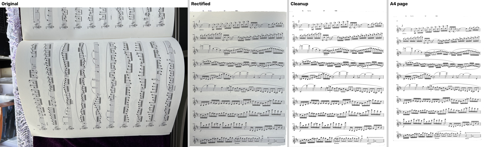
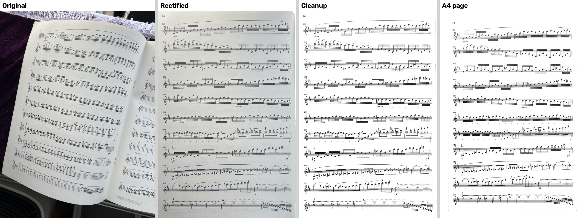
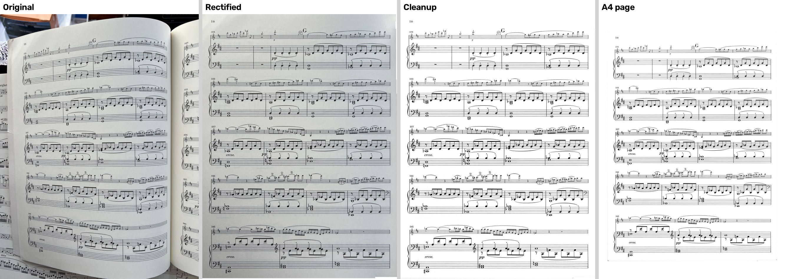
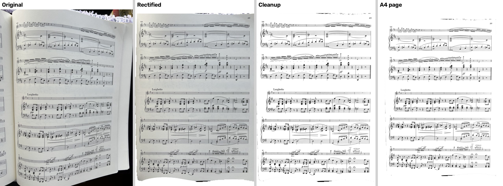
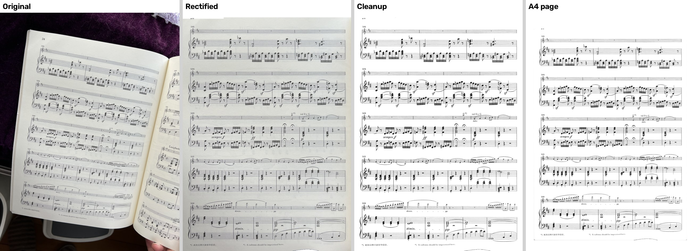

# Demo：手持拍摄的乐谱书页

5 张 iPhone 手持拍摄的摊开乐谱书（HEIC，4032 × 3024），书页弯曲、透视倾斜，背景有绒布、花边和对面那页。IMG_3682 是横着拍的（谱表竖直）。IMG_3683 书页呈扇形卷曲。IMG_3684–3686 是小提琴 + 钢琴谱，同一页上有两种大小的谱表。输出只保留主页面（命令行默认，`--keep-surroundings` 关闭）。

每张图从左到右依次为：

| 列 | 文件 | 说明 |
|---|---|---|
| Original | `images/*_original.jpg` | 原照片（已按 EXIF 方向旋正） |
| Rectified | `images/*_rectified.jpg` | 平直化后的彩色图 |
| Cleanup | `images/*_enhanced.jpg` | 阅读副本：去阴影，纸面置白 |
| A4 page | `images/*_page.jpg` | A4 竖版、300 DPI、10 mm 白边的可打印页 |

```bash
.venv/bin/python scripts/dewarp.py photos/*.HEIC --out outputs/demo --models page --crop-content
.venv/bin/python scripts/make_demo.py photos/*.HEIC --results outputs/demo --dest demo
```

`--models page` 用 U²-Netp 纸张分割去掉背景对检测的干扰，并给“只保留主页面”提供纸张范围；`--crop-content` 在曲面阶段就只取内容框，展示图用它（不加时也只保留主页面，但纸边外的零星背景斑点略多）。展示用图片缩小到长边 1600 像素，并已去掉照片的 EXIF 信息；实际输出与原照片分辨率一致。每张约 12–21 秒（Apple Silicon）。

### IMG_3682：横拍，自动转正



### IMG_3683：扇形卷曲



### IMG_3684：小提琴 + 钢琴



### IMG_3685：小提琴 + 钢琴



### IMG_3686：小提琴 + 钢琴



## 仍有的问题

- **输出范围**（2026-11-20 起只保留主页面）：对面页、弯曲的纸边和背景已去掉。`--crop-content` 下 IMG_3686 左上角页码“24”在曲面阶段的内容框外，被裁掉一半；默认整页模式保留它。
- **方向**：只判断 90°（依据检测到的谱表方向），180° 倒置未处理；简谱页不参与方向判断。
- **扇形卷曲**：IMG_3683 书页呈扇形卷曲（上几行右端上翘、下几行下垂），超出曲面模型（母线平行）的表达能力，靠残差场和纸边约束拉平；曲面拟合误差仍比其他页大。

## 2026-11-19 修复：同页多种谱表大小

小提琴 + 钢琴谱上，小提琴谱的线距只有钢琴谱的 0.55–0.7 倍。曲面拟合（B）和残差场（C）原来都假设整页谱表线距相同，把小提琴谱纵向拉到钢琴谱的大小，整页随之扭曲（IMG_3684：小节线弯曲、右侧鼓包，曲面拟合误差 p90 20 px）。现在先在照片上按线距把谱表分成大小类（`structures.spacing_classes`），“线距一致”和符头宽度尺子只在同一类内使用。IMG_3684 的拟合误差降到 p90 3.7 px。Doc3D dev 120 页：主线逐页不变，`--models page` 1 页变化（变好）。
