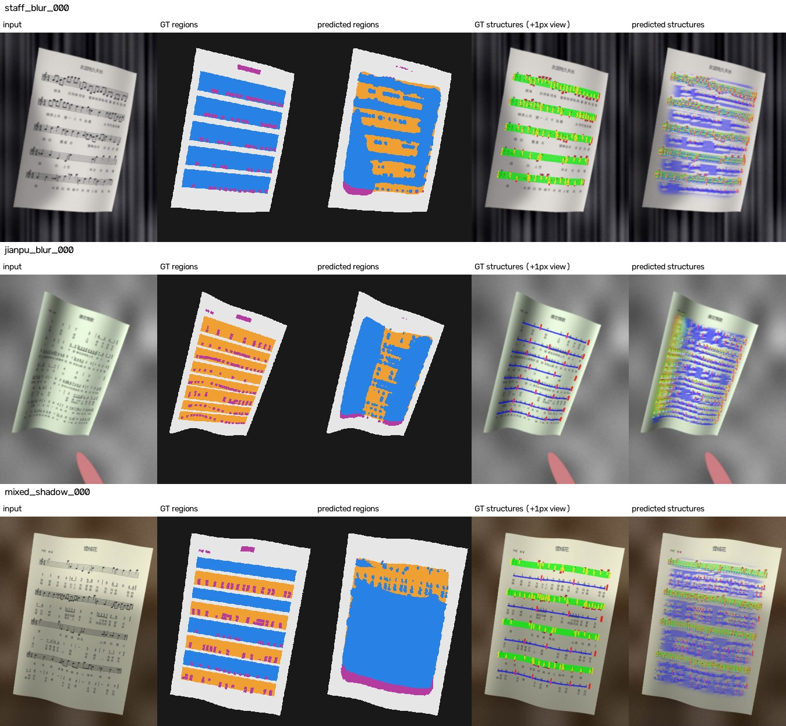

# 双域选模与辅助头训练（2026-11-15）

本轮完成双域准入规则、谱种头训练与输出接入，以及版面/结构头的独立训练和检测质量评测。仅使用训练集与开发验证集；没有读取测试集，也没有新独立测试成绩。

## 结论

- 原模型起点的谱种头：新合成验证集原始分类准确率 93.333%，固定置信度融合后 90.000%；手工检测器 73.333%。DeepScores 融合准确率 98.837%。
- 空间辅助分支：完整版面 mIoU 0.471，结构宏 F1 0.306。结构召回提升，但存在较多假阳性，尚不能直接作为 B/C 的几何观测。
- 两个起点的校正参数及 BatchNorm 缓冲区均保持逐张量不变；空间分支也保持已训练谱种头不变。新辅助头没有改变校正映射。
- 原模型起点通过绝对双域几何门槛，谱种头按固定置信度接入；数据微调起点保留上轮已有原域退化，未通过门槛，其谱种输出继续回退。

## 双域规则

- 验证：新合成 val 90 张（各谱种 30）+ DeepScores val 172 张；两个域分别检查，新合成集还逐谱种检查。
- 手工检测器基线使用宽度 1240 的校正输出；kind 输入为 384×512。实际 CLI 回归另检查默认宽度 1600。
- 参照：原始全量模型。各域/谱种的 UV EPE、AD、局部畸变、谱线/基线误差允许相对增加不超过 5%（仅加 1e-6 数值余量）；页面覆盖率最多下降 0.5 个百分点，采样方向错误率最多增加 0.05 个百分点。缺失结构标注留空，不计零误差。
- 辅助权重选择与输出准入分开：kind 按两个域等权的 balanced accuracy 保存最优；DeepScores 只有 staff，那里等价于 staff 召回。像素头按新合成集 0.5×mIoU + 0.5×结构宏 F1 选模，DeepScores 无像素标注不参与该分数。
- 谱种准入：固定置信度 0.8，低置信度回退手工检测；新合成融合 balanced accuracy 至少比检测器高 5 个百分点，DeepScores 融合准确率最多下降 1 个百分点，并通过绝对几何门槛。未经验证的旧 kind 头不会启用。
- 几何统计为训练分辨率 384×512 的原始坐标场：UV EPE 对所有 GT 页内像素计算，AD/局部畸变在 stride-8 网格计算；下表取逐页均值，不与上轮原始分辨率/实际反演映射的中位数直接横比。结构误差来自 GT 关键点，覆盖率为 GT 页内像素的预测页面覆盖。新权重还通过冻结参数指纹核对，因此实际反演输出与相应起点相同。

| 起点 | 验证域/谱种 | UV EPE% 均值 | AD% 均值 | 覆盖率% | 谱线误差 | 简谱基线 |
|---|---|---:|---:|---:|---:|---:|
| original | synthetic | 1.485 | 1.065 | 99.772 | 0.330 | 0.188 |
| original | synthetic/jianpu | 1.243 | 0.918 | 99.828 | — | 0.199 |
| original | synthetic/mixed | 1.569 | 1.062 | 99.810 | 0.334 | 0.178 |
| original | synthetic/staff | 1.642 | 1.216 | 99.677 | 0.325 | — |
| original | deepscores | 0.536 | 0.496 | 99.947 | — | — |
| adapted | synthetic | 0.682 | 0.572 | 99.860 | 0.225 | 0.115 |
| adapted | synthetic/jianpu | 0.646 | 0.536 | 99.893 | — | 0.113 |
| adapted | synthetic/mixed | 0.690 | 0.581 | 99.872 | 0.231 | 0.117 |
| adapted | synthetic/staff | 0.711 | 0.600 | 99.816 | 0.220 | — |
| adapted | deepscores | 0.593 | 0.540 | 99.950 | — | — |

## 分阶段训练

- 相同训练素材：300 张三谱种合成页 + 固定 100 张 DeepScores train 回放页；来源分组与两个验证集隔离。
- 两个起点：原始全量权重、上轮 data_only 权重。先冻结骨干和几何头（eval 模式固定 BatchNorm），用真实 bottleneck 的池化特征训练 kind MLP：120 轮、LR=0.003、batch=64、按训练类频率平衡 CE，seed=7。
- 然后训练原有 1×1 seg/struct 头：每张训练页均匀无放回采样 8,192 像素，每张验证页固定 16,384 像素；20 轮、LR=0.005，seg 类频率平方根平衡 CE，struct 正样本权重 20。缺少像素标注的 DeepScores 回放不作为负样本。
- 线性头几乎不检出简谱基线/竖线，因此在原模型起点追加空间分支：RGB + 冻结 decoder 的 32 通道特征，16 隐藏通道；seg 卷积 dilation=1,2，struct=1,2,4，GroupNorm。20 轮、LR=0.001、batch=4，seg CE + 0.5×按训练频率平衡的 BCE（权重上限 200）+ 0.5×Dice。骨干和 kind 仍冻结。
- 空间分支比较同时改变了头结构、RGB 输入与损失；不能把全部收益单独归因于卷积结构。每两轮（另含第 1 轮）做完整验证选模。所有像素特征缓存为 float16，头训练/推理为 float32。

## 谱种验证

| 起点/阶段 | 合成 kind 准确率% | 合成融合准确率% | DS kind 准确率% | DS 融合准确率% | 双域几何通过 | kind 启用 |
|---|---:|---:|---:|---:|---|---|
| original/kind | 93.333 | 90.000 | 100.000 | 98.837 | True | True |
| original/pixels | 93.333 | 90.000 | 100.000 | 98.837 | True | True |
| adapted/kind | 63.333 | 75.556 | 83.140 | 93.023 | False | False |
| adapted/pixels | 63.333 | 75.556 | 83.140 | 93.023 | False | False |

融合结果是假设按固定置信度使用该头的验证结果；实际运行还要求 kind 启用=True。adapted 行未通过门槛，所以不会实际启用其融合输出。所有完整混淆矩阵见随附 JSON。

## 独立像素与结构验证

在 90 张新合成验证页的完整像素上计算；阈值固定为 0.5。版面类别为页外/纸/谱表区/简谱区/文本歌词。下表结构通道为谱线/简谱基线/竖线。

| 起点/阶段 | mIoU | 宏 F1 | 谱线 F1 | 基线 F1 | 竖线 F1 |
|---|---:|---:|---:|---:|---:|
| original/untrained_heads | 0.158 | 0.037 | 0.065 | 0.019 | 0.027 |
| original/linear_pixels | 0.437 | 0.034 | 0.102 | 0.000 | 0.000 |
| original/pixels | 0.471 | 0.306 | 0.579 | 0.086 | 0.253 |
| adapted/untrained_heads | 0.153 | 0.037 | 0.064 | 0.020 | 0.027 |
| adapted/pixels | 0.418 | 0.035 | 0.104 | 0.000 | 0.000 |

空间分支各通道质量：

空间版面各类 IoU：页外=0.997、纸=0.700、谱表区=0.357、简谱区=0.239、文本歌词=0.062。文本/歌词区域仍是明显短板。

| 通道 | precision% | recall% | F1 | 1px 容差 F1 | 固定采样 AP |
|---|---:|---:|---:|---:|---:|
| staff | 41.972 | 93.169 | 0.579 | 0.813 | 0.690 |
| jianpu baseline | 4.491 | 94.146 | 0.086 | 0.241 | 0.181 |
| vertical | 14.594 | 95.271 | 0.253 | 0.507 | 0.383 |

1px 容差是在模型输入分辨率上计算，precision 和 recall 分别按预测/真值邻域匹配。AP 取固定均匀验证像素，阈值无关。另记录 GT 结构实例上至少 50% 像素被 1px 邻域覆盖的比例；这是 GT 行覆盖诊断，不是预测实例的一对一 precision/recall，高行覆盖不能抵消假阳性。

## 输出与后续

- 实际 CLI 回归：固定 `jianpu_blur_000` 从 unknown 改判 jianpu（置信度约 0.824）；backward map、校正图和增强图逐像素一致。
- `original_kind/validated.pt` 可用于带谱种置信度回退的校正；`original_spatial/validated.pt` 另带已训练空间分支，seg/struct 当前仅独立评测，不进入 B/C，也不替换区域或关键点导出。
- CLI 的 `page_type` 采用准入后的分类决策，`page_type_source` 标明来源，`stages.kind_decision` 保留置信度及检测器原标签；`summary` 仍描述手工检测到的结构。旧权重没有验证元数据时保持检测器分类。
- 下一步应先解决简谱基线与竖线的假阳性、文本/歌词区域的分割不足，建立实例解码与置信度校准，再研究用于几何精修。本轮没有独立测试成绩，不能把开发验证准确率当成泛化精度。

```bash
.venv/bin/python scripts/train_auxiliary.py --out outputs/auxiliary_repeat --device mps
.venv/bin/python scripts/train_spatial_auxiliary.py --experiment outputs/auxiliary_repeat --device mps
.venv/bin/python scripts/evaluate_auxiliary.py --experiment outputs/auxiliary_repeat --device mps
.venv/bin/python scripts/report_auxiliary.py --experiment outputs/auxiliary_repeat --out reports/auxiliary_repeat.md
```

本地完整权重、特征缓存、配置与历史：`outputs/auxiliary_20261115`。训练脚本要求新输出目录；源码改变时不静默复用旧缓存。

## 固定验证样本可视化

三个样本固定为 staff_blur_000、jianpu_blur_000、mixed_shadow_000，不按结果挑选。结构颜色：绿=谱线，蓝=简谱基线，红=竖线。真值结构仅在图中加粗 1px 便于观看，评测仍用原真值。


