# 乐谱校正对照图：先看局部，再看整页

[打开全部 60 页交互对照](index.html)（在浏览器打开本地 HTML；任意两个方案切换、缩放和并排滚动）

建议先比较「传统 ABC / ABC + 结构网格」，再比较「本轮网络原始输出 / 本轮网络 + 谱线网格」。整页检查标题、页码、谱行有无丢失；局部检查线条起伏、音符挤压、符干倾斜。

局部图使用同一张原图中的固定位置，上部左段、中部中段、下部右段各一处。按线距等比放大到 24px，没有额外纠斜或横纵单独拉伸。左侧蓝色短刻度表示水平等距参考。这些局部只展示选中区域，内容保留必须同时检查整页；缺失映射明确标红。

以下样本包含按内容组均匀抽样、已知退化页和边缘裁切页。每张图从左至右：传统 ABC、ABC + 结构网格、本轮网络 + 谱线网格。网络分支展示原始实验结果，未启用 CLI 的翻折回退；线条变直不代表映射已经可靠。

## IMG_1609 · 固定内容组抽样

[整页与更多方案](index.html#IMG_1609) · [打开原尺寸局部对照](sheets/IMG_1609.jpg)

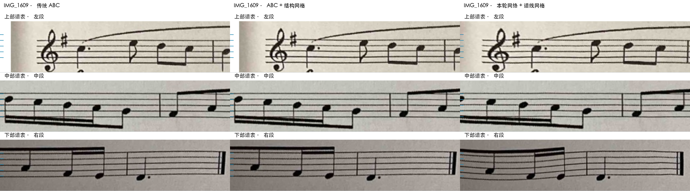

## IMG_1617 · 固定内容组抽样

[整页与更多方案](index.html#IMG_1617) · [打开原尺寸局部对照](sheets/IMG_1617.jpg)

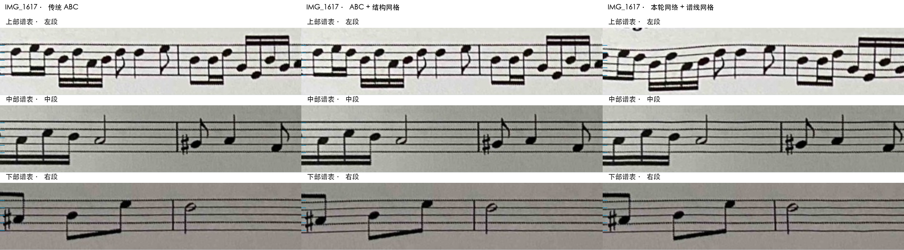

## IMG_1634 · 固定内容组抽样

[整页与更多方案](index.html#IMG_1634) · [打开原尺寸局部对照](sheets/IMG_1634.jpg)

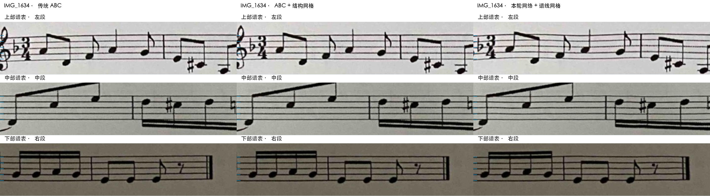

## IMG_1645 · 固定内容组抽样

[整页与更多方案](index.html#IMG_1645) · [打开原尺寸局部对照](sheets/IMG_1645.jpg)

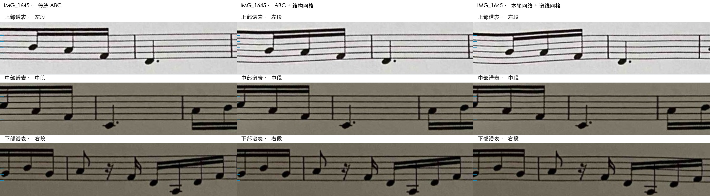

## IMG_1658 · 固定内容组抽样

[整页与更多方案](index.html#IMG_1658) · [打开原尺寸局部对照](sheets/IMG_1658.jpg)

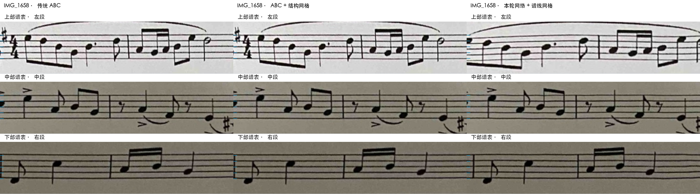

## IMG_1677 · 固定内容组抽样

[整页与更多方案](index.html#IMG_1677) · [打开原尺寸局部对照](sheets/IMG_1677.jpg)

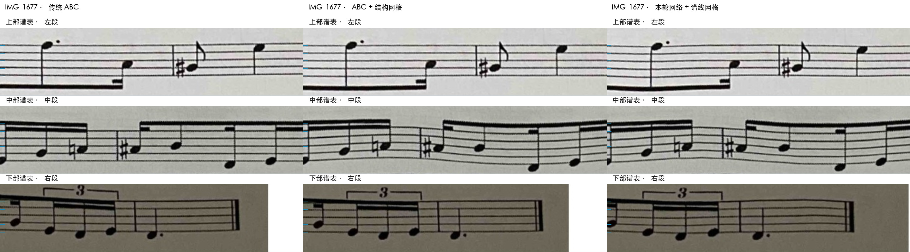

## IMG_1692 · 固定内容组抽样

[整页与更多方案](index.html#IMG_1692) · [打开原尺寸局部对照](sheets/IMG_1692.jpg)

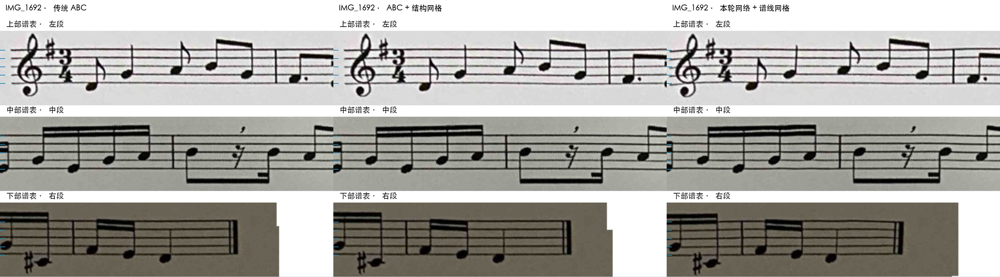

## IMG_1709 · 结构网格退化页

[整页与更多方案](index.html#IMG_1709) · [打开原尺寸局部对照](sheets/IMG_1709.jpg)

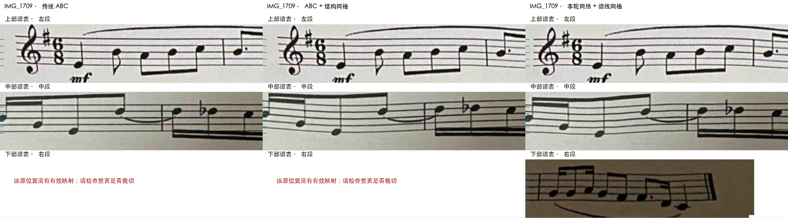

## IMG_1650 · 结构方案几乎无变化

[整页与更多方案](index.html#IMG_1650) · [打开原尺寸局部对照](sheets/IMG_1650.jpg)

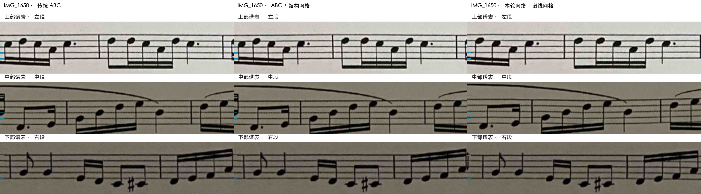

## IMG_1615 · 标题和首行谱表裁切检查

[整页与更多方案](index.html#IMG_1615) · [打开原尺寸局部对照](sheets/IMG_1615.jpg)

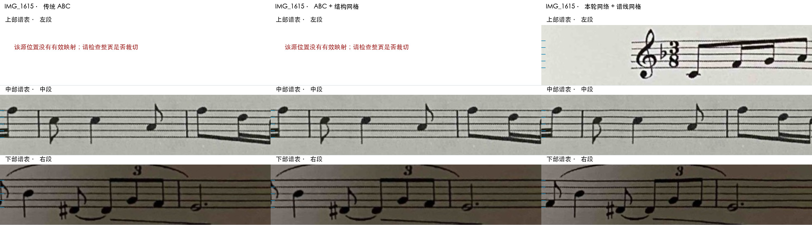

## IMG_1643 · 边缘有效像素检查

[整页与更多方案](index.html#IMG_1643) · [打开原尺寸局部对照](sheets/IMG_1643.jpg)

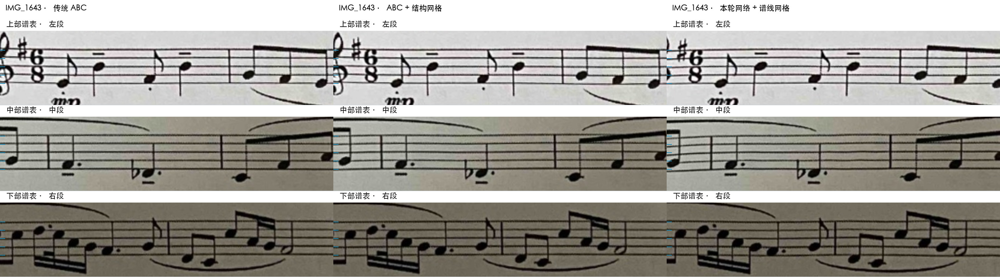
