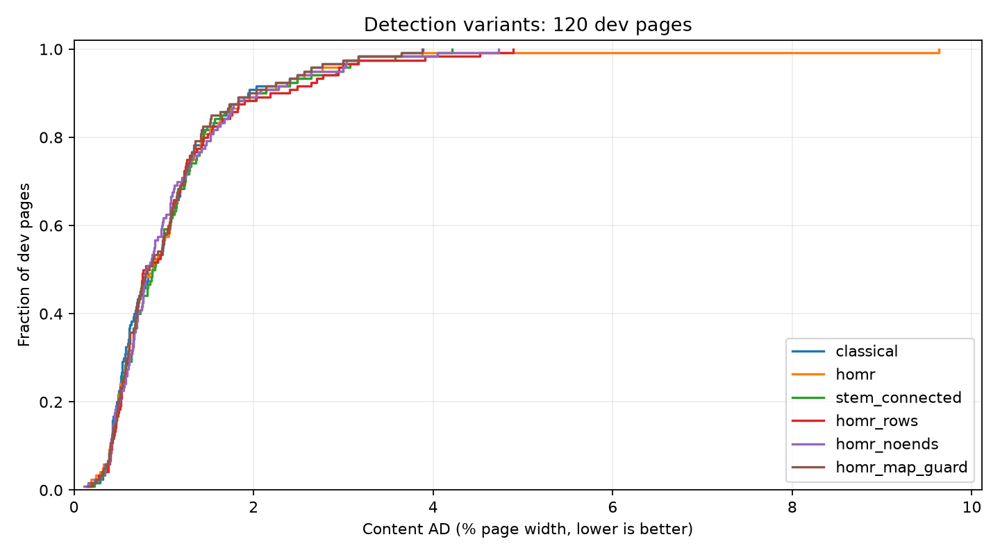

# 检测模型与几何约束：独立消融（2026-11-18）

## 问题与实验范围

验证三个问题：单独使用网络符干时补回谱线交叉处是否有效；曲面 B 的片段端点假设是否导致退化；仅凭映射局部有效性，能否在网络结果异常时回退到传统结果。

本轮不训练模型、不更改主线默认检测器或曲面默认参数，不访问 test。纸边复合评分、网络置信度校准和按谱表局部融合不在本轮实现范围内。

## 实现与方法

| 名称 | 相对主线的改动 |
|---|---|
| classical | 当前默认主线，传统检测 |
| homr | 当前 homr 融合，显式选择 staff+stem |
| stem_disconnected | 历史符干单独消融；谱线交叉处未补回 |
| stem_connected | 保持传统谱表检测，只替换符干；用网络谱线像素补回交叉处 |
| homr_rows | homr，仅把 B 的端点改为每行外侧端点（已有 gcs_ends=rows） |
| homr_noends | homr，仅将 B 的端点权重设为 0；C 的端点约束保持原样 |
| homr_map_guard | 离线重放：homr 未通过映射检查且 classical 通过时，选 classical；其他情况保留 homr，并记录未解决情况 |

符干修复通过内部 `_staff_bridge` 掩码传递谱线像素，不把它交给谱表检测，因此不同时替换谱表来源。`MetricConfig.seg_parts` 和 `stem_bridge` 显式传递到粗检测、每轮残差场检测、最终结构输出；`stem_bridge=false` 保留历史消融以供复现。默认完整 homr 路径原本已补回交叉处，行为不变。

映射检查沿用 `transforms.mapping_quality`：在四个角点都有限且位于原照片内的网格单元，检查四角 Jacobian 和奇异值。本轮在全量运行前固定：局部翻转比例必须为 0、p99 各向异性不超过 20。未使用真值选解、未根据全量结果调阈值。此规则不能保证全局单射，也不保证内容完整或几何正确；两个候选均不合格时仍保留 homr，明确记为未解决。它是离线诊断策略，尚未接入默认流程。

## 评测协议

- dev 120 页，六组实际运行；统一 canvas 分辨率，网络原照片分割复用缓存。
- 真值仅用于 AD、LD、覆盖率、谱线和版面指标。报告配对改善/不变/退化、中位数、均值、p90、极值；不变容差 1e-6，明显变化门限为 AD 的绝对 0.3 个百分点。
- 三张平整回归页：staff/jianpu/mixed，各自在最长边不超过 1600 的图像内 5%–95% 区域取 40×50 网格，使用旋转、平移、等比例缩放对齐，因此会惩罚长宽比改变。三张图仅作为回归样例。
- CPMS：60 张中固定随机抽 12 张，种子 17；比较 classical、homr、stem_connected、homr_rows。沿用 eval_cpms 的共享坐标校准，在所有输出上分别使用相同的传统裁判、homr 裁判；均为 canvas 输出。CPMS 已反复用于开发，坐标校准又依赖 homr 符头，不能当作独立泛化验证。
- 图例选择八个事先指定的历史回归样本，不作为随机效果展示。
- 平整页使用单线程 CPU ONNX 推理。真实照片在 CoreML 的临时目录权限问题排除后，使用 CoreML 完整重跑；此前中止的 CoreML 和 CPU 部分运行未并入正式汇总，其临时输出已在目录清理时删除。初次复核脚本漏传历史裁判的 `local_lines=True`，IMG_1645 的图像与历史输出逐字节相同但评分不同，核查后补齐并重新运行四组对照；正式结果目录为 `cpms_detection_20261118_local`。分割缓存共享，可能包含不同后端生成的掩码；本轮不评估后端数值一致性。并发、缓存、后端均影响耗时，不比较速度。

## 原始文件与复现

```bash
SCOREDEWARP_SEG_CACHE=outputs/segcache .venv/bin/python scripts/test_detection_route.py \
  --out outputs/bench/detection_route_20261118 --workers 6

SCOREDEWARP_SEG_COREML=0 SCOREDEWARP_SEG_CACHE=outputs/segcache \
  .venv/bin/python scripts/check_detection_photos.py --kind flat \
  --methods classical homr stem_disconnected stem_connected homr_rows homr_noends \
  --out outputs/bench/detection_flat_20261118_cpu1 --workers 1

SCOREDEWARP_SEG_COREML=1 SCOREDEWARP_SEG_CACHE=outputs/segcache \
  .venv/bin/python scripts/check_detection_photos.py --kind cpms \
  --out outputs/cpms_detection_20261118_local --workers 2

MPLCONFIGDIR=/tmp/scoredewarp_mpl .venv/bin/python scripts/plot_detection_route.py \
  --run outputs/bench/detection_route_20261118 --out reports/detection_route_20261118

.venv/bin/python -m unittest discover -s tests
```

输出目录需为空；重新运行时另选目录。每个目录的 manifest 保存样本列表和参数；主实验还记录 git 起点、代码差异及脚本哈希。原始逐页指标在各目录 rows.jsonl，离线回退选解在 guard_rows.jsonl。

## 结果

六组各 120 页，共 720 次实际运行，均无运行错误。三组历史对照（classical、homr、stem_disconnected）的 AD、LD 均逐页完全复现，最大差为 0。以下 AD 为内容区误差（页宽 %），LD 为局部畸变 %，均越低越好。

| 方法 | AD 中位 | AD 均值 | AD p90 | AD 最大 | LD 中位 | LD 均值 | LD 最大 |
|---|---:|---:|---:|---:|---:|---:|---:|
| classical | 0.875 | 1.048 | 1.939 | 3.887 | 6.923 | 8.830 | 30.525 |
| homr | 0.875 | 1.118 | 2.039 | 9.636 | 7.060 | 10.454 | 206.977 |
| stem_disconnected | 1.046 | 1.307 | 2.407 | 6.278 | 7.745 | 11.669 | 159.789 |
| stem_connected | 0.887 | 1.096 | 2.039 | 4.211 | 7.323 | 9.801 | 139.527 |
| homr_rows | 0.784 | 1.112 | 2.208 | 4.892 | 7.232 | 10.230 | 157.848 |
| homr_noends | 0.810 | 1.076 | 2.032 | 4.729 | 7.074 | 9.186 | 53.796 |
| homr_map_guard | 0.827 | 1.045 | 1.961 | 3.875 | 6.922 | 8.791 | 30.525 |

| AD 配对比较 | 改善 / 不变 / 退化 | 改善 >0.3 / 退化 >0.3 |
|---|---:|---:|
| stem_connected vs stem_disconnected | 63 / 26 / 31 | 24 / 4 |
| stem_connected vs classical | 43 / 26 / 51 | 13 / 16 |
| homr_rows vs homr | 38 / 25 / 57 | 9 / 8 |
| homr_rows vs classical | 41 / 24 / 55 | 8 / 10 |
| homr_noends vs classical | 45 / 24 / 51 | 8 / 12 |
| homr_map_guard vs classical | 23 / 80 / 17 | 3 / 4 |

**符干补连接**：相对旧消融，AD 中位 1.046 → 0.887、均值 1.307 → 1.096，明显改善 24 页、明显退化 4 页。接线修复有实测价值，原有断裂消融确实低估了网络符干；但相对默认主线仍是 43 页改善、51 页退化，LD 均值也更高，不能据此默认启用网络符干。

**端点**：按行端点的 AD 中位降到 0.784，但均值仍为 1.112，p90 2.208，LD 均值 10.230；相对 homr 是 38 页改善、57 页退化。端点权重置零也未全面优于传统主线。消除单个异常页的错误端点约束，不等于得到稳健的全页约束策略。

**局部回退**：10 页回退到传统结果，另有 78 页两个候选均未通过检查、明确留为未解决。相对 homr，AD 最大值 9.636 → 3.875、LD 最大值 206.977 → 30.525；相对默认主线，AD 均值 1.048 → 1.045，改善很小，AD p90 为 1.961（默认 1.939）。全体中位数下降不代表多数页改善：相对默认主线 80 页不变。检查范围含纸外外推，因此 78 个未解决状态不能解释为 78 个内容区失败。

分类型观察：纯简谱 24 页的六组 AD、LD 逐页完全不变；五线谱 72 页的 AD 均值默认 0.947、补连接 0.979、按行端点 1.065；混排 24 页的按行端点均值 0.932 优于默认 0.968，但补连接均值 1.114 更差。本轮未据这些分组结果另外构造按谱种选解规则。



导出的 [逐页几何指标 CSV](detection_route_20261118/metrics.csv) 包含六组实际运行和离线回退共 840 行；[真实照片评分 CSV](detection_route_20261118/cpms_metrics.csv) 包含两种裁判共 96 行。参数、环境和历史复现核对见 [reproducibility.json](detection_route_20261118/reproducibility.json)。

## 单页诊断

- **0004，严重褶皱总谱**：补连接的符干方案使 AD 2.561 → 1.282，LD 14.19 → 7.90，重复外推内容明显减少，但仍有残余弯曲和少量翻转，不能称为完全修复。[六栏图](detection_route_20261118/0004_de_staff_severe.jpg)
- **0021，中度形变五线谱**：homr 原接入 AD 1.513，按行端点变为 4.521。后者仅有 0.0027% 的翻转单元，却把下方内容明显拉伸。初版图按两位小数显示成 0.00%，现改为有效数字，避免把接近零误读为严格零。按行取外侧端点并不等于获得可靠的跨行对齐证据。[六栏图](detection_route_20261118/0021_re_staff_moderate.jpg)
- **0041，严重形变五线谱**：补连接方案的翻转单元为严格 0，p99 各向异性约 1.69，通过本轮局部映射检查，但 AD 从传统主线的 0.324 升到 1.481。这是“局部有效不等于几何正确”的实际反例。[六栏图](detection_route_20261118/0041_re_staff_severe.jpg)
- **0098，严重形变混排**：诊断复现 homr AD 9.636，按行端点 0.661，端点权重为零 0.618。但三者整张映射的翻转单元比例分别为 20.73%、1.38%、17.41%；低内容区 AD 仍可能伴随页外外推问题。局部回退规则在此选传统结果 AD 0.818。[六栏图](detection_route_20261118/0098_re_mixed_severe.jpg)

翻转比例统计的是所有符合检查条件的照片内网格单元，包含纸外背景和外推区域，不能把它直接解释成内容区失败比例。各图等比例缩小到统一展示框，不同画布的展示缩放不同，不能通过各栏内容的显示大小比较采样尺度；几何指标来自原始映射。

## 平整页回归

AD（页宽 %，等比例对齐），三张样例均完整保留采样区域：

| 页面 | classical | homr | 符干未补连接 | 符干补连接 | homr 按行端点 | homr 端点权重 0 |
|---|---:|---:|---:|---:|---:|---:|
| staff | 0.2390 | 0.2068 | 0.3053 | 0.2604 | 0.1652 | 0.2155 |
| jianpu | 0.5914 | 0.5914 | 0.5914 | 0.5914 | 0.5914 | 0.5914 |
| mixed | 0.1797 | 0.1797 | 0.1767 | 0.1801 | 0.1576 | 0.1415 |

补连接修复了五线谱样例相对旧符干消融的退化，但仍比传统主线多一点形变；混排页变化很小。端点变体在这些平整样例上较好，并不能推导出对弯曲页面同样较好。

## 真实照片固定子集

12 张，2269 个符头。传统和当前 homr 两组在两种裁判下的逐页谱位准确率，与历史 60 张中的对应记录完全一致（四组最大差均为 0）。因此可以在同一协议下比较本轮新方案。

| 方法 | 传统裁判：符头合并准确率 | homr 裁判：符头合并准确率 | homr 裁判：残余弯曲中位（线距） | homr 裁判：倾斜中位 |
|---|---:|---:|---:|---:|
| classical | 0.7329 | 0.8281 | 0.0192 | 0.0404° |
| homr | 0.7677 | 0.8268 | 0.0169 | 0.0313° |
| stem_connected | 0.7144 | 0.8334 | 0.0187 | 0.0306° |
| homr_rows | 0.7272 | 0.7937 | 0.0176 | 0.0328° |

补连接的符干方案在 homr 裁判下比传统主线高 0.53 个百分点，在传统裁判下低 1.85 个百分点，未显示稳定的谱位收益。按行端点在两种裁判下都下降。网络原接入的轻微平直度收益仍在，但谱位分数并未同步提高。以上只适用于这个开发子集；其中 IMG_1614 的坐标校准问题仍未解决，不能把这里的绝对分数当作泛化精度。

## CPMS 坐标校准审计

复查历史 60 张原始评测：校准命中率中位数为 1，但并非逐张都是 1。4 张不足 1，其中 IMG_1613 为 0.1628、IMG_1614 为 0.1488，对应成功吸附比例仅为 0.2558 / 0.2512；其余 58 张命中率均不低于 0.95。README 原先将中位数简写成“命中率 100%”，现已更正。

在原照片上按当前校准比例画标注点，能看到明显错位：[IMG_1613](detection_route_20261118/IMG_1613_calibration.jpg)、[IMG_1614](detection_route_20261118/IMG_1614_calibration.jpg)。两张错位的确切来源尚未确定；不能据此归咎于检测器。两种方法共享这些点可以维持相同比较条件，但不能把低可信坐标产生的分数解释为可靠的绝对谱位准确率。本轮固定随机子集包含 IMG_1614，保留它参加原定汇总，不根据校准率或得分删页。

## 采用决定与下一步

1. 保留符干单独消融的补连接修复及显式配置；它修正了消融的接线问题。完整 homr 路径原本已补连接，默认主线仍为 `seg=off`。
2. `gcs_ends=rows` 和端点权重为零均保留为实验，未替换默认。下一步应识别真实谱表端点及缩进/短行，核查观测数量和权重，不能仅按最外侧位置强制所有行对齐。
3. 局部检查回退保留为离线实验，不接入默认流程。应先确定主页面及可信检查区域，再加入独立的几何证据和内容完整性检查；单靠 Jacobian 不能完成候选排序。
4. CPMS 的低命中率坐标需单独人工核对；后续真实照片验证需要新的独立样本，本轮不宣称泛化提升。

验证：65 项单元测试通过，包含符干补连接且不替换传统谱表、选解不依赖真值、两个候选均无效时明确保留未解决状态；`git diff --check` 通过。静态图、CSV、运行配置与原始逐页结果均已生成，test 未运行。
