# 主线方案：可展曲面度量矫正 + 真实纸张形变基准（2026-11-17）

## 结论

项目收敛为**一条主线**：页面单应 + 纠斜（A）→ 针孔相机 + 一般柱面（可展曲面）拟合（B）→ 按方向分别平滑的残差场（R）。它已成为 `scripts/dewarp.py` 的默认方法。

在 120 页从未用于开发的测试集上（只跑了一次）：

- 内容区平均畸变 AD_c 从旧 ABC 的 1.76% 降到 0.97%，99/120 页更好；
- 局部畸变 LD_c 从 13.1% 降到 7.0%，108/120 页更好；
- 谱线平直度从 0.47 降到 0.063，90/96 页更好；
- 小节线和符干倾角从 3.4° 降到 1.7°，106/120 页更好；
- 简谱基线从 0.136 降到 0.052，44/48 页更好；
- 页面覆盖从 0.90 升到 0.998，不再裁掉标题和末行。

代价是速度：每页约 10 秒，旧 ABC 约 5.5 秒（单进程 CPU）。

## 为什么换路线

此前的方案（多轮网络 UV 回归、UVDoc、各种混合）主要在两类数据上比较：

- 自有合成器；
- CPMS 的 60 张照片。

这两种评测都有偏差：

- **自有合成器偏向 B。** 合成器的形变是"沿 X 的可展卷曲 + 针孔相机"，和 B 的模型属于同一族，用它评测 B 会偏乐观。
- **CPMS 偏向检测器。** CPMS 的平直度指标与方法共用同一个谱线检测器，而且这 60 张已经反复用于开发决策。

成熟的文档矫正方法里，凡是有可靠文本行的场景，都用"结构线 + 相机 + 可展曲面"的几何拟合（Meng et al. TPAMI 2012；page_dewarp；Kil et al. ICDAR 2017；乐谱专用的 smude 也基于 Meng 2012）。深度回归方法（DocUNet、DocTr、UVDoc 等）近年也在补线约束。五线谱的线索比文本行强得多，所以选择在旧 ABC 的几何路线上，按成熟方法重写 B。

## 评测基准：真实纸张形变上的乐谱

`scripts/make_doc3d_bench.py` 生成 `data/bench/doc3d_score/{dev,test}`，各 120 页：

- **平整页来源**：
  - 40% 是 DeepScoresV2 原测试划分的真实排版（含总谱、钢琴谱等）。谱线位置在干净数字页上，于标注的谱表框内取投影峰精确定位；符干和符头取自标注框。
  - 60% 是渲染器生成的五线谱、简谱、混排页，带完整结构标注。
- **形变来源**：Doc3D 的 UV 场。这些是真实采集的纸张网格，卷曲方向任意，还有折角和褶皱，独立于本项目的合成器和曲面模型。开发集和测试集按 Doc3D 父网格对划分，互不重叠。
- **外观**：
  - 按纸张外框加 4–14% 边距取景，模拟手机拍照时纸张占满画面；
  - 光照取自 Doc3D 原图去掉文字后的明暗；
  - 加噪声、轻微模糊和 JPEG 压缩。
- **难度分档**：按"与最佳平面单应的残差"（非平面度）三等分为 mild / moderate / severe，分档报告，不做筛除。
- **长宽比**：Doc3D 把纹理映射到单位正方形，平整页的全局长宽比没有物理意义。因此几何指标的对齐允许旋转、平移以及 X、Y 各自缩放；DocUNet 协议同样把输出缩放到参考尺寸。

指标由 `scripts/bench.py` 计算，全部来自真值，不使用本项目的检测器：

| 指标 | 含义 |
|---|---|
| ad / ad_c | 页面网格点映射到输出后，与平整位置对齐的 RMS 残差，单位为页宽 %。_c 只统计印刷内容外框内的点，裁掉页边的方法不会因此占便宜 |
| ld / ld_c | 相邻网格点差分的相对误差 %，反映局部拉伸、剪切、波动 |
| cover | 可见页面点在输出中的比例 |
| straight | 真值谱线映射后 y 的标准差 / 线距 |
| vtilt | 真值小节线和符干映射后偏离竖直的角度 |
| jp_base | 简谱数字底线 y 的标准差 / 字高 |

## 管线（`scoredewarp/core/metric_pipeline.py`、`scoredewarp/core/gcs.py`）

1. **A**：页面四边形单应 + 投影纠斜（沿用旧代码）。
2. **检测**：沿用手工检测器，有两处改动：
   - **谱线同时试局部阈值**：除全局 Otsu 外，也用局部自适应阈值找谱线，取检出谱线更多的一种。细而浅的谱线在全局 Otsu 下会被深色符头"压掉"。
   - **小线距才放大**：只有检出的谱表线距小于 9px 时，才把粗校正图放大到线距约 12px 再检测。总谱页因此从检出 2 个谱表恢复到 17 个。不能用游程统计触发：简谱页上它会测到数字笔画的周期，误触发放大，反而让简谱变差（AD_c 1.56 → 1.83）。
3. **B：一般柱面 + 针孔相机**：
   - 母线方向 φ 可估计，横截面是斜率 θ(s) 分段线性（13 个节点）的弧长曲线，纸面到三维严格等距，展开时不需要任何近似；
   - 斜率节点只覆盖观测到的结构范围，超出部分沿切线延伸，避免无数据处乱折；
   - 观测包括：五线等距的谱线、简谱字顶和字底双线、文字行、竖线（权重 5）、对齐排版下各谱表左右端点共线；
   - 先从 φ = 0° 和 90° 各短跑一段，再在较好的那个上继续；soft-L1 鲁棒核；
   - 输出范围取纸张掩码内的可见页面，而不是检测到的内容。
4. **R：残差场**：沿用 C 的线性约束框架，有三处改动：
   - **去掉剪切冻结项**：旧版要求同一列上 5 根谱线的 U 相同，等于保持当前图像的剪切，与竖线约束冲突；
   - **竖线权重提高**：从 0.6 提到 4；
   - **按方向分别平滑**：V 由大量可靠谱线决定，平滑系数 0.5；U 只有少量较短的竖线，平滑系数 3；共迭代 3 轮。

## 开发集上的调参（只用 dev）

| 配置（dev 中位数） | AD_c | LD_c | 平直度 | 竖线° | 简谱基线 |
|---|---:|---:|---:|---:|---:|
| 旧 ABC | 1.77 | 11.9 | 0.44 | 3.05 | 0.163 |
| B（可展曲面），不加残差，旧检测器 | — | — | 0.52 | 3.25 | 0.159 |
| B + C 原参数（平滑 6，竖线 0.6，已去剪切冻结项） | 1.73 | 10.5 | 0.32 | 3.50 | 0.149 |
| 竖线权重 4，统一平滑 1.5，3 轮 | 1.12 | 8.5 | 0.14 | 1.76 | 0.109 |
| 竖线权重 4，统一平滑 0.4，4 轮（过拟合） | 1.50 | 12.4 | 0.06 | 2.25 | 0.062 |
| **按方向平滑 U 3 / V 0.5（最终）** | **1.01** | **7.5** | **0.064** | **1.78** | **0.049** |

"B 不加残差"那一行跑在内容区指标引入之前，所以 AD_c 和 LD_c 空缺。统一降低平滑会让谱线更直，但几何变差：U 方向的竖线证据少，一软就过拟合；V 方向可以放软。最后三组配置差异已在噪声内，停止调参。

## 测试集结果（只评一次）

| 方法 | 失败 | AD_c | LD_c | AD | LD | 覆盖 | 平直度 | 线距CV | 竖线° | 简谱基线 | 简谱字高CV | 简谱倾角° | 秒/页 |
|---|---:|---:|---:|---:|---:|---:|---:|---:|---:|---:|---:|---:|---:|
| 原图 | 0 | 2.32 | 13.4 | 3.12 | 15.8 | 1.000 | 3.41 | 0.092 | 6.34 | 1.31 | 0.083 | 6.62 | — |
| 旧 ABC | 3 | 1.76 | 13.1 | 2.22 | 15.0 | 0.902 | 0.47 | 0.091 | 3.37 | 0.136 | 0.079 | 3.81 | 5.5 |
| 旧 ABC + 谱线网格 | 3 | 1.74 | 12.9 | 2.22 | 15.0 | 0.902 | 0.40 | 0.093 | 3.36 | 0.139 | 0.079 | 3.81 | 5.7 |
| **新主线** | 1 | **0.97** | **7.0** | **1.45** | **10.4** | **0.998** | **0.063** | **0.019** | **1.69** | **0.052** | **0.031** | **1.62** | 10.0 |

按谱种和难度分（AD_c / 平直度 / 竖线° / 简谱基线）：

| 子集 | 旧 ABC | 新主线 |
|---|---|---|
| 五线谱 72 页 | 1.84 / 0.61 / 3.3 / — | 0.91 / 0.074 / 1.9 / — |
| 简谱 24 页 | 1.47 / — / 3.3 / 0.127 | 1.09 / — / 0.9 / 0.057 |
| 混排 24 页 | 2.12 / 0.25 / 4.4 / 0.138 | 1.00 / 0.048 / 1.4 / 0.049 |
| mild 40 页 | 1.14 / 0.31 / 2.4 / 0.092 | 0.80 / 0.047 / 1.5 / 0.030 |
| moderate 47 页 | 1.84 / 0.39 / 3.7 / 0.139 | 0.99 / 0.060 / 1.7 / 0.054 |
| severe 33 页 | 2.40 / 1.29 / 5.0 / 0.207 | 1.35 / 0.142 / 1.8 / 0.098 |

"失败"指可见页面覆盖不足一半：

- **旧 ABC 的 3 页**：按内容裁切过度。
- **新主线的 1 页**（test/0115）：乐曲最后一页，内容只在上半部分。输出范围上限是"内容框外扩 35%"，下半页空白和页脚署名被截掉，内容本身完整（cover_c = 1.0）。修法见"局限"。

## 真实照片抽查（CPMS，只看图，不再计分）

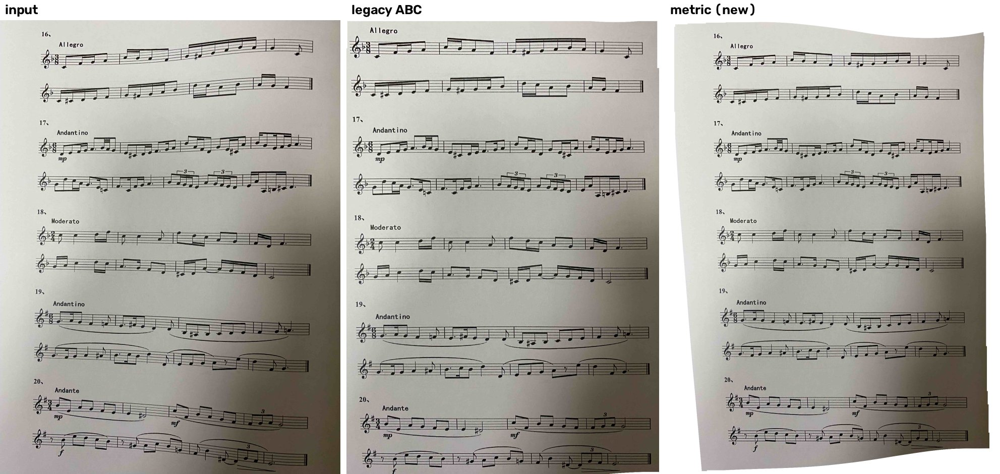
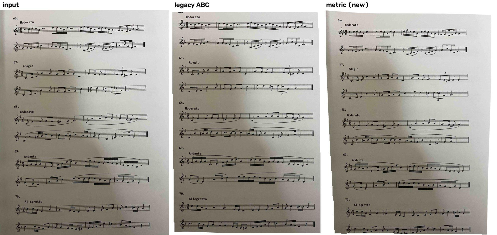
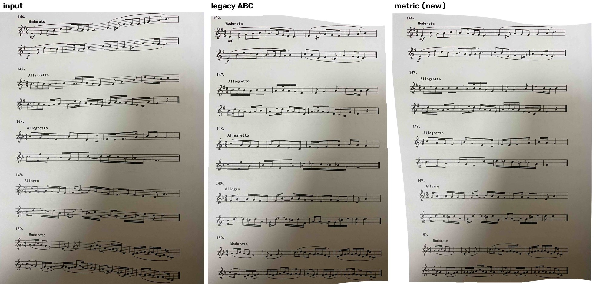

旧 ABC 会裁掉曲目编号和标题，新主线保留整页，谱线直。基准样例：

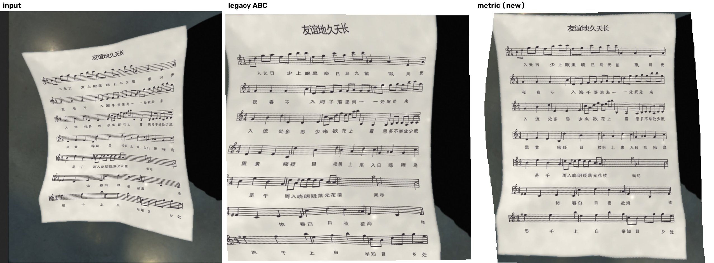
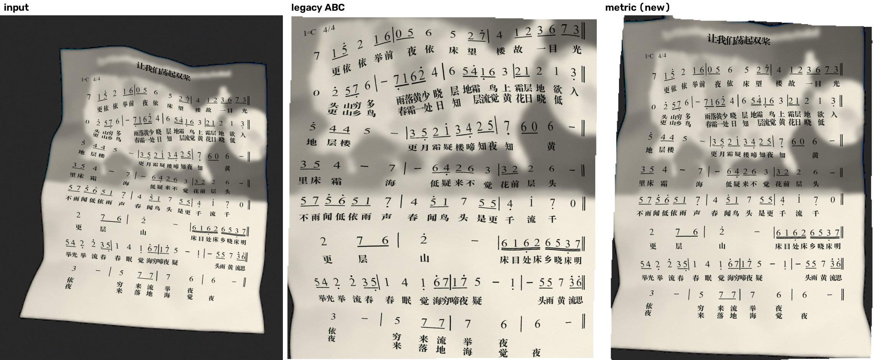
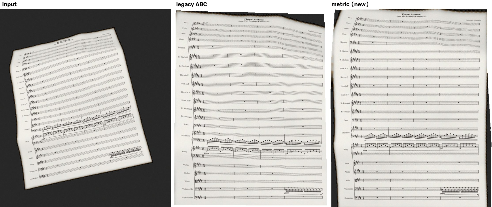

## 局限与下一步

1. **输出范围上限**：检测到纸张掩码时，应允许扩展到整张纸，而不是"内容框 + 35%"，即 test/0115 的问题。这是测试之后才发现的，按规则未改，下次在 dev 上验证。（2026-11-18 已处理，见下节。）
2. **简谱行检测**：数字行在阴影和较强弯曲下会被切成多段，并误判为文字行，导致约束的字高混乱。简谱仍是最弱的一类，dev 上 AD_c 比五线谱高。可以用 DeepScores / 渲染器的真值训练一个小分割网络，代替手工的谱线和文字行检测；这是"学习只用在检测上"，不回到 UV 回归。
3. **严重形变**：折角是锥面，母线不平行，单一柱面表达不了，现在靠残差场兜底。severe 档的 LD_c 仍约 10%。
4. **页边锯齿与阴影**：纯外观问题，不影响几何。
5. **速度**：每页约 10 秒，主要花在 B 的两个起点和 3 轮残差上，可以并行或降采样观测。
6. **基准的局限**：Doc3D 是 448px 采集后上采样，细褶皱被平滑掉了；光照是从原文档图近似得到的。真实照片只做了抽查。

## 2026-11-18 补充：纸张边缘与阅读副本

只在 dev 上调整；test 未重新计分，只用 test/0115 目视确认了上面第 1 条的修复。

### 纸张边缘

做法：
1. **纸张掩码**：先用亮度掩码，再用 GrabCut 细化。种子取"内容结构（谱表、简谱行、文字行）的凸包 = 一定是纸"、"亮度掩码 = 可能是纸"、"画面边缘带 = 可能是背景"。单一亮度阈值在强阴影和聚光下会丢掉暗的纸面：dev 上亮度掩码只有 32/120 页能包住 97% 以上的内容，GrabCut 之后绝大多数页都能做到。
2. **候选边**：掩码轮廓按对角极值点分成上、下、左、右四段。去掉圆角、贴着画框的部分，以及颜色梯度弱的点（软阴影边界、掩码穿过平坦区域的地方）。
3. **筛选**：先只用内容拟合曲面，把候选点映射到展平后的纸面，在纸面上做 RANSAC 直线拟合（真纸边在纸面上是 X 或 Y 为常数）。外侧还有内容结构的边丢弃（那是阴影或光斑的边）；掩码包不住 97% 内容时整页不用边。只用内容结构做这两项检查：自由的横线片段和竖线可能正是纸边本身（test/0115 就是这样）。
4. **用途**：通过筛选的边决定输出范围（越过纸边留 1.5% 余量），不再受"内容框 + 35%"的限制。

把纸边也作为曲面拟合的直线约束（`edge_mode=fit`）在 dev 上不划算：内容区 AD 约 50 页变好、70 页变差，权重降到 0.2 也一样。原因是 Doc3D 的纸在边缘处卷得最厉害，单一柱面要同时拉直内部和卷边，会把内部拉歪。所以默认只用来定范围（`edge_mode=extent`），几何与之前相同；页边仍有轻微波浪，不影响读谱。

dev 结果（相对无纸边版本，几何差异是输出尺寸变化带来的噪声级波动）：

| | 无纸边 | 默认（纸边定范围） |
|---|---:|---:|
| 内容区 AD 中位数 | 1.009 | 0.985 |
| LD 均值 | 13.17 | 12.46 |
| 页面覆盖 均值 | 0.983 | 0.988 |
| 页面覆盖 最差页 | 0.517 | 0.638 |
| 每页耗时 中位数 | 10.6 s | 10.9 s |

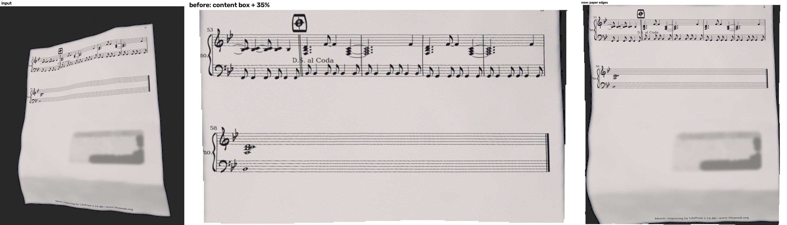

### 阅读副本（`_enhanced.png`，`--binary` 另存黑白版）

- **去阴影**：背景用灰度闭运算估计，核略大于最粗的笔画（约 1.6 倍谱线间距），再做同尺寸中值滤波，然后原图除以背景。旧做法用大核最大值滤波加高斯模糊，会把锐利的投影边界抹开，留下一圈阴影轮廓；闭运算保留边界位置。
- **对比度**：把淡墨拉暗、纸纹拉白；黑白版阈值取 Otsu 与白之间的一半，细而淡的谱线不至于断开。
- **纸外置白**：用管线里的纸张掩码（GrabCut 细化后、且包得住内容时）映射到输出，取凸包并内缩 1%，把纸边那条暗线也置白；靠近纸边 8% 的带内（页边空白，没有内容），掩码外或大片很暗的区域也置白。

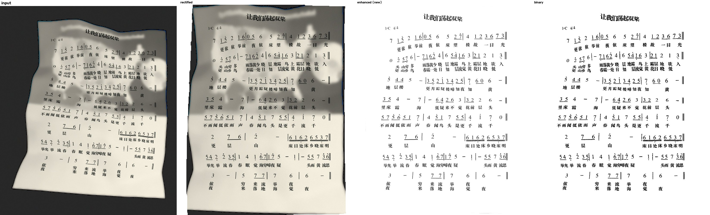
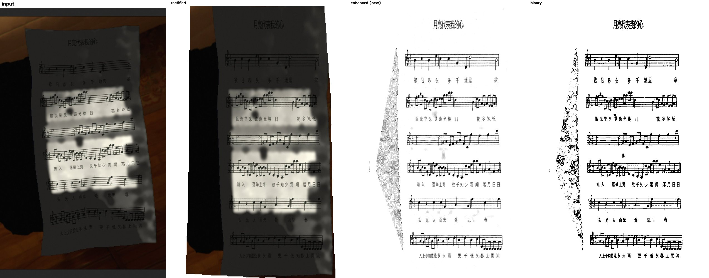
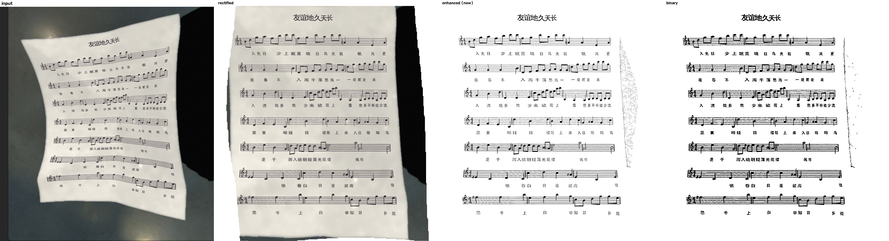
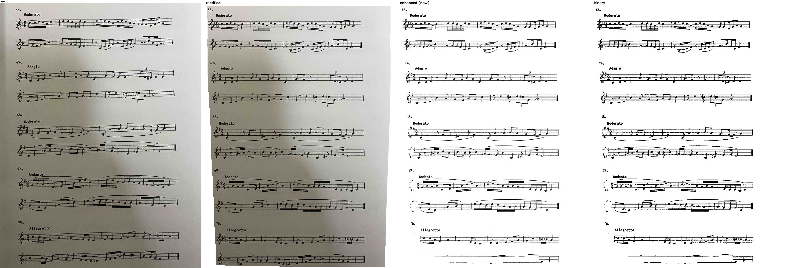

已知不足：掩码漏进相邻的暗背景、且漏得比边缘带更深时（上面 0006 右侧的灰色桌面、0026 左侧的黑布），阅读副本里会留一块浅色噪点。内容本身不受影响。

产物：`outputs/bench/dev_edges1..5`（`dev_edges5` 为最终默认）。

## 复现

```bash
.venv/bin/python scripts/make_doc3d_bench.py --out data/bench/doc3d_score --per-split 120
.venv/bin/python scripts/bench.py --data data/bench/doc3d_score/dev  --methods input abc abc_mesh metric --out outputs/bench/dev
.venv/bin/python scripts/bench.py --data data/bench/doc3d_score/test --methods input abc abc_mesh metric --out outputs/bench/test_final
# 参数化变体（覆盖默认值）：
.venv/bin/python scripts/bench.py --data data/bench/doc3d_score/dev --methods "gcs:c.lam_v=0.3,w.vseg=3" --out outputs/bench/x
.venv/bin/python scripts/bench_report.py outputs/bench/dev outputs/bench/x --methods abc metric "gcs:c.lam_v=0.3,w.vseg=3" --base abc
.venv/bin/python scripts/make_route_figures.py --out reports/metric_route_20261117
.venv/bin/python scripts/dewarp.py photo.jpg --out outputs/run --binary   # 默认新主线，另存黑白阅读副本
.venv/bin/python scripts/bench.py --data data/bench/doc3d_score/dev --methods metric "gcs:edges=false" "gcs:edge_mode=fit" --out outputs/bench/edges
.venv/bin/python scripts/dewarp.py photo.jpg --method traditional --out outputs/abc
```

本次产物：`outputs/bench/dev_legacy2`（旧方案 dev）、`outputs/bench/dev_grid1..4`（调参）、`outputs/bench/test_final`（测试，一次）。

## 2026-11-18 补充二：读谱者看得见的对齐（小节线平行、谱号对齐、行水平）与内容完整

只在 dev 上调整和评测；test 未动。

### 新增指标，以及 bench 的一个盲区

`scripts/bench.py` 新增三项，都来自真值：

| 指标 | 含义 |
|---|---|
| bar_jp | 简谱小节线偏离竖直的平均角度（°） |
| bar_jp_sd | 同一页简谱小节线角度的标准差（°），0 表示全部平行 |
| lalign | 各谱表左端（谱号处）的最大横向错位，单位为线距；对真值位置做仿射拟合，首行缩进不计 |

行是否水平看 jp_base（每行数字底线的离散度）。jp_tilt 量的是单个数字是否直立，不是行是否水平。

**盲区**：Doc3D 的长宽比没有物理意义，几何指标的对齐允许 X、Y 各自缩放。以前的角度类指标（vtilt 等）直接在输出坐标里量，**把整页横向压窄，所有竖线的倾角就会跟着变小**。现在所有结构指标都先经过 AD 的整页对齐，再测量。

这个盲区确实被利用过。残差场的竖线约束是“同一笔画上 U 相等”，整个 U 被压缩时这些残差会同比例变小，所以竖线权重越大，求解器越倾向于把页面压窄。旧默认已经把简谱页压到原宽的约 0.8（最窄 0.4），五线谱页约 0.92。旧指标下看起来不错的几组参数（竖线权重 8、U 平滑 1.5），主要是在压窄页面；前文 test 表里“竖线倾角 3.4° → 1.7°”也是用旧量法得到的，含有这个偏差。

### 改动

1. **残差场的尺度规范（`keep_scale`）**：在 U、V 的最小二乘里各加一条高权重约束，要求平均梯度为 1。全局尺度和长宽比由 B 的相机模型决定，残差场只修局部。`stages["field_scale"]` 和 bench 的 `field_aspect` 记录残差场对长宽比的改变，现在恒为 1.000。（先试过求解后再缩放回来，但三轮迭代来回拉扯，有几页 AD 变差，所以改为放进求解。）
2. **残差场按内容锚定（`anchor`）**：原来只是让所有网格节点的平均位移归零，形变集中在内容区时，内容会被推出画布。在 IMG_1650 上，题号“66、”和谱号被切掉了一半。现在用检测到的结构点算出内容外框，保持左、上页边不变；右、下方向放不下时扩大画布（中位数 +1.3%，最多 +14%）。
3. **线距和字高门限（`spacing_gate`）**：线距偏离中位数超过 20% 的谱表，原来保留自己的线距（为小号谱表准备），结果恰好是 B 拟合最差的谱表不会被纠正。现在一律拉到全页中位数。
4. **谱表左右端对齐（`ends_w=2`）**：各谱表最左端（谱号）、最右端的 U 相等，鲁棒求解，首行缩进会被当成离群点。参考 Stamatopoulos et al. 2011 用版心左右边界作约束；B 里已有同类项。
5. **按页面类型设残差场参数**：简谱页竖线权重 8（小节线和汉字竖笔画都是可靠的竖线），混排页 U 平滑 1.5。五线谱页保持原样：密排总谱线距只有 7px，升降号、符杠的碎段也会被当成“竖线”，加权以后 AD 变差。
6. **GrabCut 固定随机种子**：同一张照片，纸张掩码、纸边和输出范围每次运行都一致。
7. **阅读副本不再擦掉内容（`protect_content`）**：纸张掩码可能穿过真实内容，比如纸张超出取景框、阴影漏进掩码。现在把墨迹膨胀约 1 个线距连成内容块，凡是至少 25% 落在纸内、墨迹密度不低于 0.15 的块整块保留。背景布纹等纹理的密度只有约 0.04，不受影响。IMG_1650 最后一行谱和左侧谱号已恢复。

### dev 结果（11-17 默认 → 11-18 默认，结构指标已在对齐后的坐标系里测量）

| 指标（均值 / p90） | 11-17 | 11-18 | 变好 / 变坏页数 |
|---|---:|---:|---:|
| AD_c | 1.227 / 2.21 | 1.161 / 1.88 | 18 / 6 |
| 线距 CV | 0.050 / 0.15 | 0.035 / 0.07 | 18 / 4 |
| 竖线倾角 vtilt（°） | 1.53 / 2.43 | 1.39 / 2.27 | 23 / 2 |
| 简谱小节线倾角 bar_jp（°） | 1.61 / 3.69 | 1.18 / 3.24 | 26 / 0 |
| 小节线平行度 bar_jp_sd（°） | 2.43 / 6.27 | 1.80 / 5.66 | 31 / 1 |
| 谱号左端错位 lalign（线距） | 0.81 / 1.76 | 0.79 / 1.75 | 20 / 18（无显著变化） |
| 简谱行平直度 jp_base | 0.166 / 0.37 | 0.158 / 0.39 | 11 / 8（无显著变化） |
| 页面覆盖 cover | 0.988 | 0.987 | — |

“变好 / 变坏”只统计变化超过该指标中位数 25% 的页。每页耗时不变。

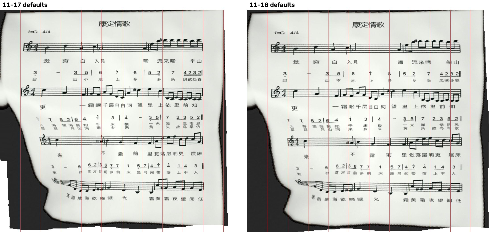
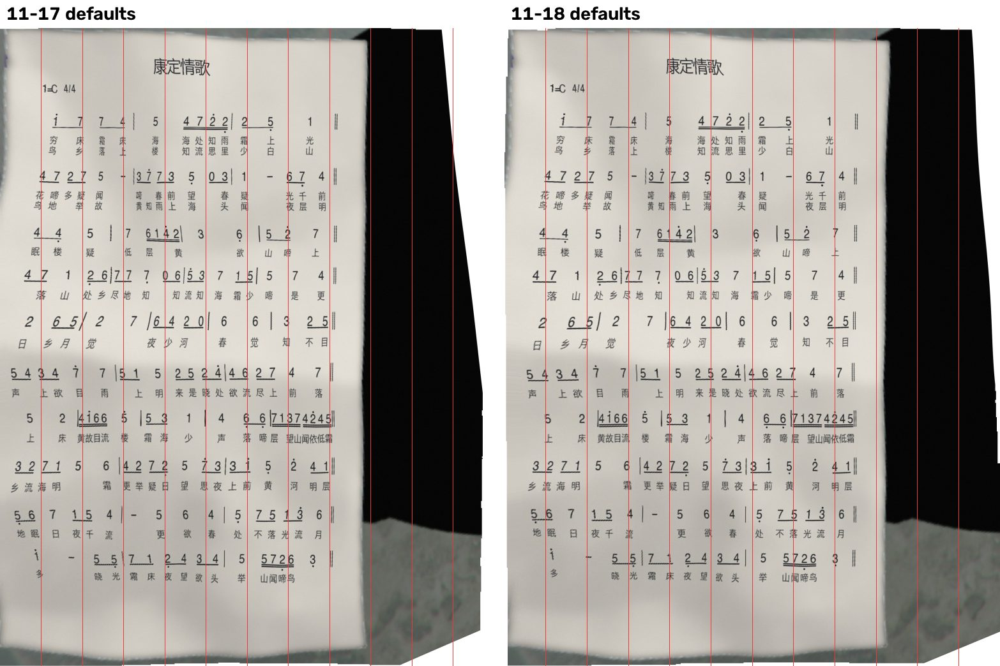
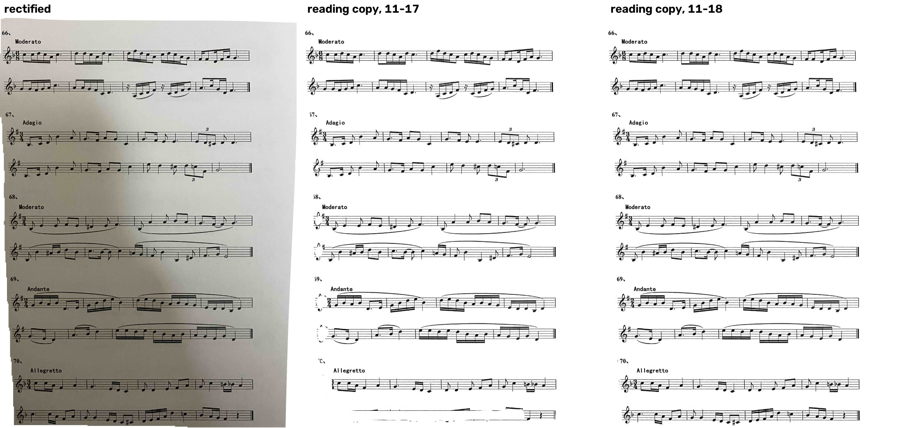

### 试过但没有采用

- **简谱 U 平滑 1.5**：小节线更直了，但简谱页 AD 从 1.36 升到 1.60，mild 页翻倍。
- **竖线一致性过滤**（丢掉与邻近竖线角度相差超过 3° 的笔画）：小节线反而更歪，过滤掉的多是真小节线。
- **端点权重 4**：AD 恶化到 1.68。
- **简谱断行合并（`merge_rows`）**：把被大间隔、高低音点切断的数字行重新拼接。单页上看效果正确，但整体的简谱基线从 0.106 恶化到 0.154，有误合并。保留为开关，默认关闭。

### 仍未解决

- **谱号对齐（lalign）和简谱行水平（jp_base）** 靠调参改不动。最差的页是检测问题：谱表被判成文字行（dev/0021 有 6 个谱表只检出 2 个），简谱行被大间隔、高低音点和下划线切成多段，导致字高约束错乱。根本解决还是用渲染器和 DeepScores 的真值训练一个谱表 / 行分割网络，取代手工检测。
- test 已经用过一次，而指标的量法也改了。这一轮的改进只在 dev 上验证过，积累到一定程度后，应该用未使用过的 Doc3D 组新建 test2，只评一次。

```bash
.venv/bin/python scripts/bench.py --data data/bench/doc3d_score/dev --methods metric \
    "gcs:c.spacing_gate=0.2,c.ends_w=0.0,c.keep_scale=false,j.vseg_w=4.0,m.lam_u=3.0" --out outputs/bench/x   # 11-18 vs 11-17
.venv/bin/python scripts/make_align_figures.py --out reports/metric_route_20261117
```

产物：`outputs/bench/dev_align0..9`（`dev_align7` 为 11-17 默认按新量法重测，`dev_align9` 为 11-18 默认）。
