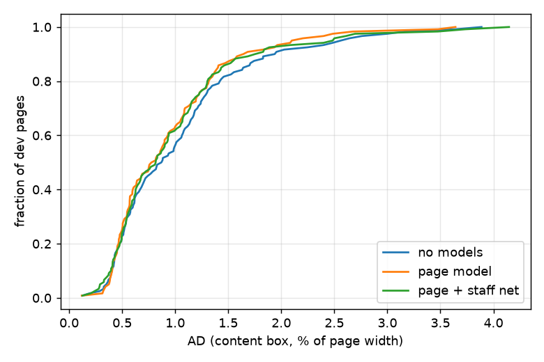

# 小模型检测 + 几何求解：让模型方案超过无模型方案（2026-11-19）

## 结论

只用两个小的检测模型（不做学习形变），模型方案在 dev 120 页上超过了无模型方案；也超过了"无模型 + 同等额外计算量"的对照。手持拍书照片目视主页面 7 张更好、6 张持平、0 张更差。

| dev 120 页 | AD 中位 | AD 均值 | AD p90 | AD 最大 | LD 中位 / 均值 / p90 | 谱线平直 均值 / p90 | 竖线倾角 中位 / 均值 | 梯形 均值 | 耗时中位 |
|---|---:|---:|---:|---:|---:|---:|---:|---:|---:|
| 无模型（当前默认） | 0.875 | 1.048 | 1.939 | 3.89 | 6.92 / 8.83 / 15.9 | 0.311 / 0.701 | 0.753 / 1.102 | 3.72 | 13.4 s |
| 无模型 + 折叠检查 + 双起点完整优化（同等额外计算） | 0.856 | 1.001 | 1.752 | 3.92 | 6.97 / 8.37 / 13.8 | 0.302 / 0.659 | 0.776 / 1.087 | 2.64 | 19.5 s |
| **`--models page`**（纸张分割） | **0.796** | **0.950** | **1.646** | **3.64** | 6.65 / **8.23** / 14.5 | **0.250** / 0.598 | **0.687** / 0.972 | 2.38 | 18.7 s |
| `--models all`（纸张分割 + homr 谱线） | 0.817 | 0.985 | 1.760 | 4.15 | **6.50** / 8.41 / 15.5 | 0.268 / **0.479** | 0.704 / **0.947** | **2.25** | 22.8 s |

AD 为内容区误差（页宽 %），LD 为局部畸变 %，均越低越好；耗时在多进程并发下测得，只作参考。逐页对默认：`page` 改善 66 / 退化 47（变化超过 0.3 个百分点：16 / 12）；`all` 58 / 55（16 / 8）。

- **起主要作用的是纸张分割模型**：4.6 MB 的通用前景分割网络 U²-Netp。它在三处使用：证据只取纸面，A 段缺四边形时补纸面四边形，B 段按纸边矩形度在候选解中选解。
- **homr 五线谱网络**：改为逐谱表融合，且只用谱线、符干仍用传统检测后，不再损害竖线。在真实照片（CPMS）上，两种裁判读出的符头谱位准确率都提高，残余弯曲 −26%、倾斜 −52%。在 dev 上它改善平直度和页边指标，AD 略逊于只用纸张模型。
- 分类型 AD 均值（默认 → page / all）：五线谱 0.947 → 0.894 / 0.941，简谱 1.430 → 1.266 / 1.266，混排 0.968 → 0.803 / 0.836；轻度页持平，中度、重度页改善。
- 默认仍为无模型，两个预设通过 `--models page|all` 开启。test 集未使用。

## 业内与文献的做法

| 来源 | 做法 | 与本项目的对应 |
|---|---|---|
| 扫描类 App / SDK、YOLOv8-seg + 几何的混合管线（[arXiv 2501.03145](https://arxiv.org/abs/2501.03145)） | 先用轻量分割网络找纸张（掩码 / 四边形），再做透视等几何处理 | **此前缺这一步**：本轮的 `pagenet` |
| DocTr、DocScanner 等文档矫正网络 | 第一步用轻量前景分割（U²-Net 系）去背景 | 同上；本轮用通用 U²-Netp，未用 Doc3D 训练的权重，避免与基准泄漏 |
| RDGR（Jiang et al., CVPR 2022，[arXiv 2203.16850](https://arxiv.org/abs/2203.16850)） | UNet 检测文本行和**文档边界点**，网格优化要求行与边界在矫正后保持直线 | 已有"行"（谱线、简谱行）；本轮用纸边做**解的选择**（`select_by_outline`），也试了直接做约束（`edge_prefit`） |
| oemer（[dewarp.py](https://github.com/BreezeWhite/oemer)）/ homr（[repo](https://github.com/liebharc/homr)） | 谱线分割网络 + 插值去扭曲；homr 逐谱表矫正 | 已有 homr 分割；本轮改融合方式 |

几类做法的共同点：小模型负责"找纸"和"找线"，几何负责求解。其中"找纸"是最普遍、最先做的一步；此前项目只接入了"找线"。

## 诊断：为什么 homr 单独接入效果不理想

1. **网络只用在残差场 C 时完全中性**：AD 均值 +0.001，`seg_stages=c`。B 输出上的谱线已接近水平，传统检测在那里本来就准。网络用在 B 时出现尾部崩坏，0098 的 AD 为 9.6。
2. **逐页二选一的规则让多数页面根本没用上网络**：120 页中 70 页结果与无模型完全相同。其中 24 页为简谱，网络不参与；其余 46 页因网络谱线总长不如传统而整页回退。
3. **检测级真值评测（96 页五线谱 / 混排，粗矫正画布上）**：

   | 检测 | 谱表召回 | 精确率 | 竖笔画倾角偏差 | 竖笔画倾角误差中位 |
   |---|---:|---:|---:|---:|
   | 传统 | 0.871 | 0.982 | −0.33° | 0.68° |
   | homr，逐页 | 0.917 | 0.981 | −0.27° | 0.71° |
   | homr，逐谱表融合 | 0.918 | 0.961 | +0.01° | 0.76° |
   | 传统 + 纸面掩码 | 0.878 | 0.978 | −0.27° | **0.62°** |

   网络符干无偏，但噪声更大。残差场逐笔画信任竖线，噪声的代价大于去掉偏差的收益：网络符干使输出竖线倾角在 71 / 118 页变差。改为只用网络谱线后，倾角反而改善。
4. **主要误差源不在线检测**：
   - B 的局部解"彩票"：证据稍变，约四分之一页面的 AD 变化超过 0.3。
   - 曲面外推越过折叠，输出出现镜像的重复内容。
   - A 段缺四边形或旋转大：18 / 120 页没有亮度四边形，0107 的页面转了约 25°，行链接失败。
   - 背景杂物：木纹、砖墙、布褶被检测为自由横线、竖笔画（B 中权重 5）和文本行。

   以上都与谱线检测好坏无关，所以检测指标提升了，展平却不变。

## 改动（全部为开关；默认行为不变）

| 开关 | 内容 | 位置 |
|---|---|---|
| `page_seg=u2netp` | U²-Netp 纸张掩码（Apache-2.0，DUTS 训练，4.6 MB，随仓库 `models/u2netp/`），填洞，取包含谱面结构的连通域。**门控**：面积 8%–97%、实心度 ≥ 0.85、包含 ≥ 97% 的无掩码检测谱面点，否则不用。CPMS 整幅特写上显著性网络会把谱表本身当前景，门控拒绝 59 / 60 张。通过后只取纸面上的证据，掩码腐蚀 0.2% 照片宽 | `core/pagenet.py`，`_detect(page=…)` |
| `page_quad` | 亮度法找不到四边形时，用掩码凸包拟合四边形；四边须有纸 / 背景灰度台阶（`edge_support`），否则视为整幅纸面而拒绝 | `pagenet.page_quad` |
| `b_select=outline` | 两个母线方向起点都优化完成，在代价不超过最优 1.5 倍的解中，选掩码纸边在展平页上最接近轴对齐矩形的解（各边中段的中位绝对偏差） | `GCSModel.outline_score / select_by_outline` |
| `quad_alt` | 使用了模型四边形时，另在无四边形坐标系拟合一次，按同一纸边得分取优 | `metric_pipeline._surface` |
| `sheet_content` | 纸面上的印刷都算内容，输出范围不得切掉（卷角上的页码曾被纸边直线截掉） | `grow_to_content(sheet=…)` |
| `extent_fold`（无模型） | 输出范围在曲面折叠处停止：雅可比方向与内容区相反或塌缩、或与内容区不连通的展平点不计入 | `GCSModel._unfolded` |
| `seg_fuse=staff`、`seg_parts=staff` | 逐谱表融合：网络谱表为底；网络漏掉的传统谱表补入；同一谱表传统覆盖长 1.3 倍以上时用传统；网络谱表允许跨符号桥接。符干仍为传统 | `structures._fuse_staves` |
| 预设 `MODEL_PRESETS` / CLI `--models off\|page\|all` | 上表组合 | `metric_pipeline.py`、`scripts/dewarp.py` |

## 评测协议

- **dev 120 页**（Doc3D 真实形变重贴图，背景为 Doc3D 原场景）：配对比较；"不变"容差 1e-6；"明显"为 AD 变化 0.3 个百分点。每个变体都有无模型对照。纸边选解需要两个起点都完成优化，因此另设"无模型 + 双起点完整优化（按代价选）"作为同等计算量对照。test 未运行。
- **检测级**：96 页五线谱 / 混排，真值谱表和符干映射到粗矫正画布。
- **CPMS 60 张**（11092 个标注符头）：沿用 `eval_cpms` 的坐标校准，两个固定裁判（传统、homr）读取输出上的符头谱位。CPMS 已多次用于开发，不能算独立泛化验证。
- **手持拍书照片 13 张**（`data/manual_photos`），逐张目视：只评主页面，对页另记。
- 全程定期目视输出：检测叠加图、纸张掩码、最好 / 最差页面板。几处数值与观感不一致的情况见下文"走过的弯路"。

## 结果

### dev 逐页面板

纸张模型改善最大的四页与退化最大的三页（输入 / 无模型 / page / all）：

- 改善：[0114](model_route_20261119/0114_de_staff_severe.jpg)、[0052](model_route_20261119/0052_re_jianpu_moderate.jpg)、[0107](model_route_20261119/0107_re_jianpu_severe.jpg)、[0004](model_route_20261119/0004_de_staff_severe.jpg)。0052 无模型时几乎没有矫正（透视和背景都在），模型版是完整展平的页面；0107 是旋转约 25° 的简谱页，模型四边形使行链接恢复。
- 退化：[0045](model_route_20261119/0045_de_staff_severe.jpg)（中间有折痕的页，page 版纵向拉伸，all 版正常）、[0111](model_route_20261119/0111_re_staff_severe.jpg)（顶部谱表仍弯）、[0095](model_route_20261119/0095_de_staff_severe.jpg)（右上卷角处变形）。都是重度页，B 落到较差的解。



### CPMS（60 张真实照片）

| 方法 | 传统裁判：合并准确率 | homr 裁判：合并准确率 | 残余弯曲中位（线距） | 倾斜中位 |
|---|---:|---:|---:|---:|
| 无模型（折叠检查） | 0.7565 | 0.8786 | 0.0204 | 0.042° |
| `page` | 0.7558 | 0.8783 | 0.0204 | 0.042° |
| `all` | **0.7627** | **0.8902** | **0.0150** | **0.020°** |

弯曲与倾斜在 homr 裁判下测得。逐张对比：`all` 的残余弯曲在 56 / 60 张（homr 裁判）、48 / 60 张（传统裁判）上更小。谱位准确率在 homr 裁判下 35 张好 / 23 张差，传统裁判下 28 / 29，后者基本持平。`page` 在 CPMS 上只对 1 张生效（IMG_1707，右侧露出背景）：传统裁判准确率 0.691 → 0.646，目视与无模型几乎相同。

### 手持拍书照片（13 张，目视）

主页面：7 张模型版更好（3669、3670、3672、3673、3674、3675、3679：谱线由弯 / 斜变直，页面成矩形），6 张持平，0 张更差。另外两点：

- 3671、3675、3676 的输出范围包含对页，对页部分被拉花。
- 3680 是横拍照片，两种方法都没转正（90° 方向尚未处理）。

面板在 `outputs/manual_check_20261119/`（含私人照片，不入库）。

## 走过的弯路（均已修正或放弃）

- **掩码腐蚀 1%**：会去掉纸边本身这一有效证据，0085 的 AD 从 1.30 升到 4.65。改为 0.2%。
- **`edge_prefit`**（纸边直接作为 B 的直线约束）：0085 有改善，0114 的 LD 升到 62。未采用。
- **只用模型四边形**：0107 大幅改善，0070、0095、0110 变差。由 `quad_alt` 加纸边选解取代。
- **网络符干**：使竖线倾角变差。改为只用网络谱线。
- **数值与观感不一致的两处**：
  - 书本照片乍看"主页面被压扁"，按同一比例裁剪后发现只是画布更宽造成的显示缩放。
  - 3670 数值上没有问题，但页码被截。由此加了 `sheet_content`。
- **一次批跑全部报错作废**：函数内局部 import 引起 UnboundLocalError。已重跑，并新增端到端冒烟测试 `tests/test_pipeline_smoke.py`，覆盖默认和所有模型开关组合。

## 局限与下一步

1. **B 的局部解仍是最大噪声源**。纸边选解只在两个起点之间选；候选可以扩展到更多起点和多种证据组合，验证指标也可以加入谱线 / 竖线一致性。
2. **对页处理**：已有书脊切分（`spread_cut`），但对页的谱线未被检测为谱表时不触发；对页仍出现在输出中并被拉花。
3. **简谱没有学习检测**，仍是最差类型（AD 均值 1.27）。按 RDGR 思路，可以用渲染器加 Doc3D 形变（排除 dev / test 的形变组）训练一个轻量的简谱行 / 竖笔画分割头。
4. 90° / 180° 方向未处理。
5. **耗时**：`page` 中位约 +5 s，`all` 约 +9 s（并发下测得）。主要来自两个起点都完成优化和 homr 推理。

## 复现

```bash
# dev：默认 / page / all（images/ 为面板来源）
SCOREDEWARP_SEG_CACHE=outputs/segcache SCOREDEWARP_SEG_COREML=0 .venv/bin/python scripts/bench.py \
  --data data/bench/doc3d_score/dev --methods metric models_page models_all \
  --out outputs/bench/final_models_20261119 --workers 7 --save-images
.venv/bin/python scripts/plot_model_route.py --run outputs/bench/final_models_20261119 --out reports/model_route_20261119

# 单张照片
.venv/bin/python scripts/dewarp.py my_score.jpg --models page      # 或 --models all
.venv/bin/python -m unittest discover -s tests
```

中间消融的原始逐页结果：

| 目录 | 内容 |
|---|---|
| `outputs/bench/seg_stage_20261119` | 网络只用于 B / 只用于 C |
| `outputs/bench/pageseg_20261119` | 折叠检查、纸面掩码 |
| `outputs/bench/quadfuse_20261119` | 模型四边形、逐谱表融合 |
| `outputs/bench/b4_20261119` | 腐蚀 0.2%、纸边选解、只用谱线、同等计算量对照 |
| `outputs/bench/b5_20261119` | `quad_alt` |
| `outputs/bench/det_eval_20261119.jsonl` | 检测级 |
| `outputs/cpms_models_20261119` | CPMS |

除最终一组外，中间各组运行时的代码与最终代码不完全相同（例如 `sheet_content` 在 b5 之后加入）。表中最终数字均来自 `final_models_20261119`。

## 补充：页边距约束用于选解（`b_select=outline_margin`，未采用）

思路：谱面的纸边就是谱表块往外一圈，展平后各边页边距应恒定。对每个候选解，把谱表块和纸边都映射到它的展平页上：谱表块取各行左右端的连线、首行顶线、末行底线，纸边来自分割掩码。计算"纸边 − 谱表块线"在各边中段的离散度，加到原来的纸边矩形度得分上再选解。实现见 `GCSModel.margin_score`。

| dev 120 页 | AD 中位 / 均值 / p90 / 最大 | LD 均值 / p90 | 谱线平直 p90 | 竖线倾角 p90 | 梯形 最大 |
|---|---:|---:|---:|---:|---:|
| `page`（纸边矩形度） | 0.796 / 0.950 / 1.646 / 3.64 | 8.23 / 14.5 | 0.598 | 1.80 | 16.8 |
| `page` + 页边距 | 0.798 / 0.939 / 1.587 / 3.64 | 8.13 / 14.2 | 0.631 | 1.90 | 16.8 |
| `all`（纸边矩形度） | 0.817 / 0.985 / 1.760 / 4.15 | 8.41 / 15.5 | 0.479 | 1.73 | 16.9 |
| `all` + 页边距 | 0.817 / 0.982 / 1.698 / 4.15 | 8.34 / 15.2 | 0.481 | 1.81 | 22.1 |

- **只有约 1/7 的页面结果改变**：`page` 17 页、`all` 12 页。其余页面两个起点收敛到同一个解，选解无从发挥。
- **改变的页面有好有坏**：
  - `page`：9 页好、8 页差。0095 的 AD 2.68 → 1.37（转为无模型四边形坐标系），0024 0.34 → 0.19；0049 0.40 → 0.60，0081 0.55 → 0.67。
  - `all`：0045 0.67 → 1.19，0100 1.75 → 2.29（梯形 22%）。这几页目视差别很小，属于两个接近的解之间选错。
- **结论**：AD 均值和 p90 略好，结构指标的尾部略差，在噪声范围内，不改预设。

页边距作为**选解得分**作用有限，因为候选太少。要让它在多数页面起作用，须作为拟合中的软约束（下一步）。残差场 C 中已有"各行谱表端点 U 相等"，因此页边距恒定等价于再加上"纸边点 U 相等 / V 相等"，并按纸边可信度（中段、非卷边）赋权。原始结果：`outputs/bench/margin_20261119`。
