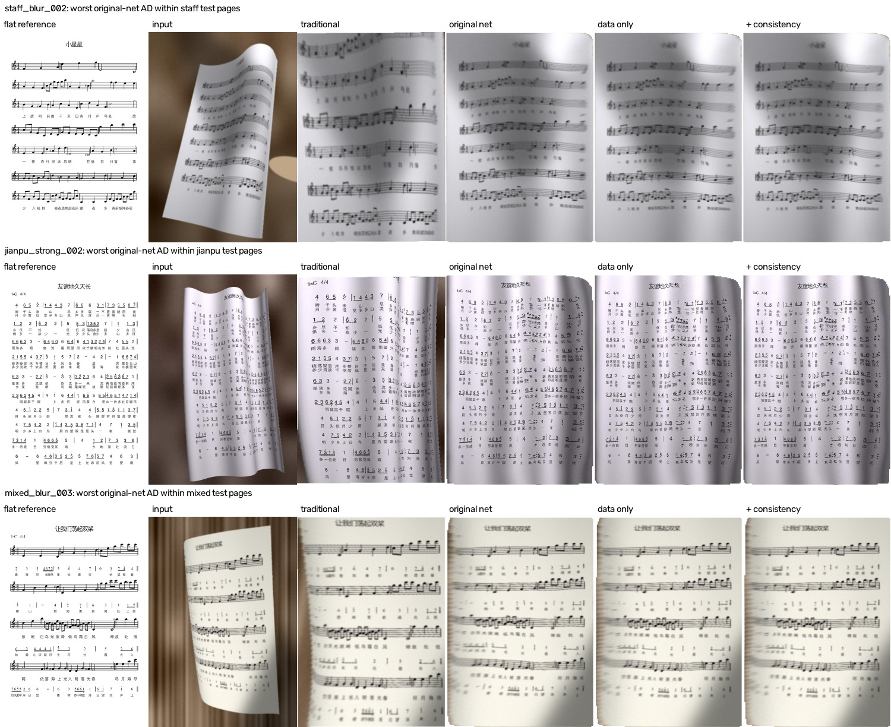

# 固定合成基准与简谱/混排结构一致性训练（2026-11-15）

本轮先建立分层合成基准，再完成两组受控微调；所有素材与形变均为合成。

## 本轮结论

- 主要收益来自补充训练数据：保留测试中，简谱 own AD 中位数 0.745% → 0.435%，混排 0.866% → 0.422%。各网络网格覆盖率中位数约 98.5%–98.7%；逐页共同点比较同样支持改善，详见配对表。
- 结构一致性额外收益较小：简谱 own 基线误差 0.081 → 0.076，混排 own 谱线误差 0.131 → 0.129；两组验证 UV EPE 几乎持平。
- 未形成全面更优的替代：结构约束组混排谱种正确率 56.667%，低于数据组 66.667%；DeepScores 原域 AD 从 0.383% 上升至两组约 0.448%。
- 两组权重均保留，暂不切换通用默认权重。下一步应补训结构/版面/谱种辅助头，并在验证集选模时同时加入原域保持要求；之后用新的保留素材验证，不继续用本轮 test 调参。

## 固定数据与实验协议

- 新素材共 480 张：train/val/test = 300/90/90；每个集合内三种谱种均衡。
- 五档条件：轻度形变（strength=0.5）、标准（1.0）、强形变（1.3）、强制投射阴影、固定模糊 sigma=1.8。后两档仍使用 strength=1.0；其他降质保持随机。
- 每个 val/test 的“谱种 × 条件”格子有 6 张；每类共 30 张。每页独立随机种子、来源分组及文件 SHA-256，无重复平整页或跨集合来源重叠。
- 生成时在 97×129 网格的每格两个三角形检查投影方向，最小有符号面积/中位面积需大于 0.02；失败则重采样形变，保留平整页内容。该采样检查不等于连续可逆性的数学证明。
- 模拟照片为 768×1024；本轮统一输出宽度 1240。不同于此前宽度 1600 的结果，不直接跨报告比较检测指标。
- 两组训练使用完全相同的 300 张新合成页和固定抽取的 100 张 DeepScores train 回放页。
- 从既有全量权重初始化，输入 384×512，seed=7，batch=8，LR=1e-4，余弦下降，24 轮，无早停；各组按 90 张新 val 的平均逐页 UV EPE 保存最佳权重。
- data_only：坐标、梯度、页面掩码损失；structure_consistency：额外加入权重 50 的结构实例一致性损失（水平结构的平面 Y 方差、竖直结构的平面 X 方差）。
- 两组均冻结 seg/struct/kind 输出头，避免多任务监督混入对照；最终谱种仍来自手工检测器。该实验验证几何坐标的结构约束，尚未训练结构热图检测头。
- 两组训练及选模完成后才评测保留 test；test 不用于调参。DeepScores 172 张 val 用于检查原域保持情况。

基准 manifest SHA-256：`a8d286b9e2497cf66929c97c707b28d74ba730216ceacdc2f7c19b2fda07fb8e`。

## 训练结果

| 组别 | 初始 val UV EPE% | 最佳 val UV EPE% | 最佳轮 | 步数 | 耗时 min |
|---|---:|---:|---:|---:|---:|
| data_only | 1.485 | 0.682 | 20 | 1200 | 21.2 |
| structure_consistency | 1.485 | 0.680 | 20 | 1200 | 42.7 |

耗时为 wall time，包含运行中的长间隔，不用于比较两组计算性能。


## 开发验证集（90 张）

共 450 条方法记录，运行异常 0 条。误差与覆盖率均取逐页中位数；缺失指标留空。
own AD 与覆盖率一起阅读；common 结构指标使用传统方案与三个网络均有效的交集。

| 谱种 | 方法 | own AD% | own 覆盖率% | common 谱线平直度 | common 简谱基线 | 谱种正确率% |
|---|---|---:|---:|---:|---:|---:|
| staff | traditional | 1.113 | 70.911 | 0.077 | — | 93.333 |
| staff | full_ca_lr1e-3_s7 | 1.075 | 98.522 | 0.263 | — | 96.667 |
| staff | data_only | 0.468 | 98.706 | 0.171 | — | 96.667 |
| staff | structure_consistency | 0.467 | 98.664 | 0.160 | — | 96.667 |
| jianpu | traditional | 0.868 | 77.472 | — | 0.060 | 66.667 |
| jianpu | full_ca_lr1e-3_s7 | 0.851 | 98.444 | — | 0.167 | 63.333 |
| jianpu | data_only | 0.505 | 98.545 | — | 0.112 | 66.667 |
| jianpu | structure_consistency | 0.500 | 98.565 | — | 0.103 | 70.000 |
| mixed | traditional | 0.954 | 75.567 | 0.095 | 0.044 | 53.333 |
| mixed | full_ca_lr1e-3_s7 | 0.889 | 98.559 | 0.255 | 0.135 | 60.000 |
| mixed | data_only | 0.423 | 98.561 | 0.150 | 0.086 | 63.333 |
| mixed | structure_consistency | 0.415 | 98.591 | 0.150 | 0.085 | 63.333 |

谱表检测按所有三种谱种的实例汇总（简谱页上误检出的谱表同样计入假阳性）：

| 方法 | 匹配/预测/真值 | precision% | recall% |
|---|---:|---:|---:|
| traditional | 213/222/298 | 95.946 | 71.477 |
| full_ca_lr1e-3_s7 | 229/236/298 | 97.034 | 76.846 |
| data_only | 234/240/298 | 97.500 | 78.523 |
| structure_consistency | 229/235/298 | 97.447 | 76.846 |

逐页配对差值（前者 − 后者；负值为改善）。每对方法使用自己的共同有效点，避免传统方案的低覆盖率掩盖网络之间的差异。

| 谱种 | 对比 | ΔAD% 中位数 | AD 改善/有效页 | Δ谱线平直度 | Δ简谱基线 |
|---|---|---:|---:|---:|---:|
| staff | data_only − full_ca_lr1e-3_s7 | -0.5151 | 30/30 | -0.109 | — |
| staff | structure_consistency − data_only | 0.0005 | 14/30 | -0.006 | — |
| jianpu | data_only − full_ca_lr1e-3_s7 | -0.3571 | 29/30 | — | -0.082 |
| jianpu | structure_consistency − data_only | -0.0012 | 16/30 | — | -0.002 |
| mixed | data_only − full_ca_lr1e-3_s7 | -0.4561 | 30/30 | -0.094 | -0.048 |
| mixed | structure_consistency − data_only | -0.0038 | 22/30 | -0.005 | -0.002 |

按条件分层的几何误差（逐页 own AD% 中位数，每格 18 张，仍需结合完整报告中的覆盖率）：

| 条件 | 传统 | 原模型 | data_only | structure_consistency |
|---|---:|---:|---:|---:|
| mild | 0.637 | 0.714 | 0.297 | 0.295 |
| standard | 0.921 | 1.079 | 0.451 | 0.445 |
| strong | 1.193 | 1.280 | 0.603 | 0.612 |
| shadow | 0.969 | 0.883 | 0.465 | 0.453 |
| blur | 1.861 | 0.792 | 0.489 | 0.496 |

## 保留测试集（90 张）

共 450 条方法记录，运行异常 0 条。误差与覆盖率均取逐页中位数；缺失指标留空。
own AD 与覆盖率一起阅读；common 结构指标使用传统方案与三个网络均有效的交集。

| 谱种 | 方法 | own AD% | own 覆盖率% | common 谱线平直度 | common 简谱基线 | 谱种正确率% |
|---|---|---:|---:|---:|---:|---:|
| staff | traditional | 1.342 | 71.443 | 0.082 | — | 86.667 |
| staff | full_ca_lr1e-3_s7 | 0.960 | 98.574 | 0.229 | — | 90.000 |
| staff | data_only | 0.437 | 98.698 | 0.139 | — | 90.000 |
| staff | structure_consistency | 0.443 | 98.709 | 0.136 | — | 90.000 |
| jianpu | traditional | 0.802 | 77.606 | — | 0.040 | 60.000 |
| jianpu | full_ca_lr1e-3_s7 | 0.745 | 98.488 | — | 0.147 | 70.000 |
| jianpu | data_only | 0.435 | 98.608 | — | 0.081 | 73.333 |
| jianpu | structure_consistency | 0.434 | 98.628 | — | 0.076 | 73.333 |
| mixed | traditional | 0.953 | 79.889 | 0.076 | 0.051 | 63.333 |
| mixed | full_ca_lr1e-3_s7 | 0.866 | 98.698 | 0.268 | 0.159 | 56.667 |
| mixed | data_only | 0.422 | 98.731 | 0.131 | 0.074 | 66.667 |
| mixed | structure_consistency | 0.422 | 98.729 | 0.129 | 0.072 | 56.667 |

谱表检测按所有三种谱种的实例汇总（简谱页上误检出的谱表同样计入假阳性）：

| 方法 | 匹配/预测/真值 | precision% | recall% |
|---|---:|---:|---:|
| traditional | 221/232/300 | 95.259 | 73.667 |
| full_ca_lr1e-3_s7 | 231/244/300 | 94.672 | 77.000 |
| data_only | 223/233/300 | 95.708 | 74.333 |
| structure_consistency | 232/241/300 | 96.266 | 77.333 |

逐页配对差值（前者 − 后者；负值为改善）。每对方法使用自己的共同有效点，避免传统方案的低覆盖率掩盖网络之间的差异。

| 谱种 | 对比 | ΔAD% 中位数 | AD 改善/有效页 | Δ谱线平直度 | Δ简谱基线 |
|---|---|---:|---:|---:|---:|
| staff | data_only − full_ca_lr1e-3_s7 | -0.5148 | 30/30 | -0.116 | — |
| staff | structure_consistency − data_only | -0.0003 | 18/30 | -0.007 | — |
| jianpu | data_only − full_ca_lr1e-3_s7 | -0.3109 | 29/30 | — | -0.067 |
| jianpu | structure_consistency − data_only | -0.0026 | 18/30 | — | -0.003 |
| mixed | data_only − full_ca_lr1e-3_s7 | -0.4605 | 29/30 | -0.103 | -0.052 |
| mixed | structure_consistency − data_only | 0.0002 | 15/30 | -0.002 | -0.001 |

按条件分层的几何误差（逐页 own AD% 中位数，每格 18 张，仍需结合完整报告中的覆盖率）：

| 条件 | 传统 | 原模型 | data_only | structure_consistency |
|---|---:|---:|---:|---:|
| mild | 0.524 | 0.724 | 0.315 | 0.315 |
| standard | 1.077 | 0.851 | 0.409 | 0.406 |
| strong | 0.875 | 0.866 | 0.554 | 0.545 |
| shadow | 1.448 | 0.904 | 0.469 | 0.466 |
| blur | 1.155 | 0.825 | 0.459 | 0.457 |

## DeepScores 原域保持（172 张 val）

这里使用反演前的网络坐标场，与本表原模型比较；与上面实际输出映射的 AD 不直接横比。覆盖率为均值，误差为中位数。

| 模型 | AD% | 局部畸变% | 覆盖率% | 方向错误率% 均值 |
|---|---:|---:|---:|---:|
| full_ca_lr1e-3_s7 | 0.383 | 3.189 | 99.946 | 0.059 |
| data_only | 0.448 | 3.592 | 99.947 | 0.059 |
| structure_consistency | 0.448 | 3.618 | 99.947 | 0.059 |

## 解释范围与复现

权重保存在本地实验目录的 `data_only/best.pt` 与 `structure_consistency/best.pt`；原始全量权重没有覆盖。训练配置、历史、曲线、完整评测与数据清单均保留。
单 seed、固定 24 轮的受控实验；不能据此声称不同随机种子上收益稳定。结构一致性约束只包含水平/竖直实例方差，不包含完整的五线等距、字高或歌词对应损失。
投影筛选只作用于本轮新合成素材；DeepScores 回放沿用既有 prepared 数据。完整性复核确认原始权重、15 个训练/评测源码文件及 1,920 个新素材文件的校验和未变，两组的 8 个辅助头张量均与初始化相同。
各档并非互斥的困难因素：标准与强形变档仍可能随机出现阴影、遮挡或模糊。生成投影通过采样方向检查，但预测仍可能折叠，需结合方向错误率、往返检查及覆盖率判断。
首版 train/val 的投影审计发现 9 张局部翻折，已停止初步训练并保留诊断输出；本报告只采用加生成时投影过滤的 v2。修正发生在查看保留 test 的模型表现之前，不依据 test 调参。
谱种正确率与谱表实例精度不等价。完整的五线谱/简谱指标、谱表匹配数、失败页、条件分层结果和配对支持点结果见本地 experiment 输出。

```bash
.venv/bin/python scripts/prepare_structure_suite.py --out data/prepared/structure_suite_20261115_v2
.venv/bin/python scripts/check_external_data.py data/prepared/structure_suite_20261115_v2
.venv/bin/python scripts/run_structure_ablation.py --device mps
```

生成脚本要求新的空目录；已完成的实验可由运行脚本复用完成标记，未完成的权重或评测目录不会被静默覆盖。
本地完整结果：`outputs/structure_ablation_20261115_v2`。

## 困难页对照

每种谱种选原模型 AD 最高的测试页，不按新模型改善程度挑选。左到右为平整参考、输入、传统方案、原模型、只增加数据、增加结构一致性。


