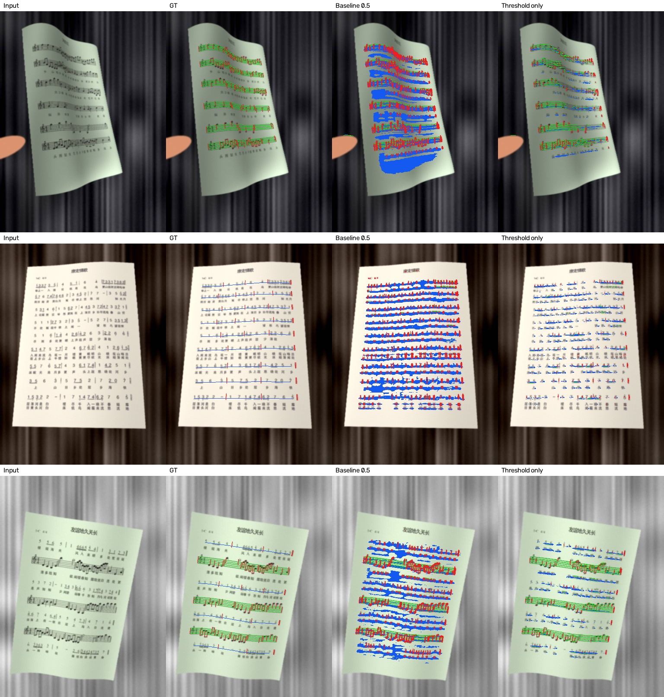

# 结构热图阈值校准与独立合成验证（2026-11-15）

本轮完成分通道阈值校准、方向性局部极大值压细对照、独立合成评测和可直接运行的结构掩码导出工具。没有新增训练，没有改动校正模型或现有校正流程。

## 结果与采用方案

采用**仅分通道阈值**作为独立导出工具的默认方案。阈值在既有开发验证集上固定后，才生成并评测 90 张独立合成页；没有依据这些新页的成绩重新调整参数。

| 方法 | 严格像素宏 F1 | 1px 容差宏 F1 |
|---|---:|---:|
| 原始统一阈值 0.5 | 0.307 | 0.523 |
| **分通道阈值** | **0.458** | **0.688** |
| 分通道阈值 + 方向压细 | 0.449 | 0.665 |

分通道方案严格像素宏 F1 相对提高约 49%。按“谱种 × 条件”分层的配对页面 bootstrap（1,000 次，seed=731）中，1px 容差宏 F1 的增量 95% 区间为 **[+0.1565, +0.1757]**。区间只刻画这批合成页的抽样不确定性，不代表换生成器或真实照片的泛化区间。

压细方案在开发集上已经低于仅调阈值（容差宏 F1 为 0.659 vs 0.684），独立页上也未胜出，保留为显式实验选项。轴向压细可能打断陡斜/弯曲线，并降低召回，当前不默认使用。

## 校准与验证协议

- 冻结权重：`outputs/auxiliary_20261115/original_spatial/validated.pt`，输入 384×512。权重 SHA-256：`0eacf6ad6f079af6d52db007294652c35440e7de159099b276e19a1ab3b2e679`。
- 校准集：既有 `structure_suite_20261115_v2/val` 的 90 页。原空间头也曾在该集合上选模，因此校准集成绩不视为独立泛化成绩。
- 候选阈值：0.05–0.99、步长 0.01，另加 0.995/0.999。各通道分别最大化全像素汇总的 1px 容差 F1；并列时取较低阈值。不使用 GT 谱种、区域或页面掩码来过滤预测。
- 仅阈值方案：谱线 **0.86**、简谱基线 **0.95**、竖线 **0.98**。压细方案：0.90/0.95/0.98，局部极大值半径固定为 2；谱线/基线沿 Y 压细，竖线沿 X 压细。
- 先保存 `selected.json` 并锁定其 SHA-256，再生成独立素材。参数文件 SHA-256：`7de0f60d2a80cb5fd6cdeaee141061983ec1b20f595cfe7af0385275ae81b841`。
- 独立素材 seed=2026111502，三谱种 × 五条件 × 每格 6 页，共 90 页。条件为轻度、标准、强形变、投射阴影、模糊，沿用原生成器与采样投影方向检查。
- 对五份既有 prepared manifest 检查 source group/seed 重叠；对两版结构基准已记录的 flat/photo SHA-256 检查内容重叠，均为 0。新素材内部也无重复组、平整页或照片。没有打开旧测试集的图像或标签。
- 全部新素材坐标有限且范围正确，页面覆盖率最小 30.9%；生成文件校验和保存在新 manifest。不同 seed 不等于字体、标题或生成规则的语义隔离；这些结果仍只代表同一合成分布。
- 容差在模型输入分辨率上计算，使用 3×3 邻域：precision 计预测像素是否靠近 GT，recall 计 GT 像素是否靠近预测，两者使用各自的匹配计数；缺失通道的指标留空，假阳性仍计入。

## 独立验证分通道结果

下表为严格像素指标，precision/recall 为百分比。阈值优化目标为 1px 容差 F1，因此也同时公开严格定位指标及召回代价。

| 通道 | 原 precision | 新 precision | 原 recall | 新 recall | 原 F1 | 新 F1 |
|---|---:|---:|---:|---:|---:|---:|
| 谱线 | 42.4 | 56.5 | 92.5 | 82.1 | 0.581 | 0.670 |
| 简谱基线 | 4.6 | 20.1 | 93.9 | 36.0 | 0.087 | 0.258 |
| 竖线 | 14.5 | 36.1 | 95.1 | 58.8 | 0.252 | 0.447 |

1px 容差下，新方案的 precision/recall 分别为：谱线 81.2%/90.9%，简谱基线 43.1%/56.3%，竖线 63.0%/83.6%。阈值过滤显著减少误检，但不能弥补模型缺失的定位和结构表达能力，尤其简谱基线的严格召回仍低。

## 分条件与分谱种

| 条件 | 原严格宏 F1 | 新严格宏 F1 | 原容差宏 F1 | 新容差宏 F1 |
|---|---:|---:|---:|---:|
| mild | 0.326 | 0.498 | 0.543 | 0.718 |
| standard | 0.314 | 0.473 | 0.532 | 0.714 |
| strong | 0.278 | 0.415 | 0.497 | 0.660 |
| shadow | 0.310 | 0.471 | 0.521 | 0.697 |
| blur | 0.309 | 0.417 | 0.525 | 0.644 |

| 谱种 | 原严格宏 F1 | 新严格宏 F1 | 原容差宏 F1 | 新容差宏 F1 |
|---|---:|---:|---:|---:|
| staff | 0.350 | 0.413 | 0.545 | 0.582 |
| jianpu | 0.085 | 0.201 | 0.196 | 0.339 |
| mixed | 0.321 | 0.477 | 0.545 | 0.713 |

每一组均按三通道计算，组内不存在的 GT 通道上若有预测，仍会受到假阳性惩罚。因此 staff 组的宏 F1 不等于只计算谱线通道的 F1。

## 使用与复现

```bash
# 重新校准并生成相同协议的独立页；要求新的空输出目录。
.venv/bin/python scripts/calibrate_structure.py \
  --out outputs/structure_calibration_repeat --device cpu

# 导出任意输入图像的结构热图、二值掩码和叠加图。
.venv/bin/python scripts/predict_structures.py \
  outputs/structure_calibration_20261115/fresh/val/jianpu_blur_000/photo.jpg \
  --checkpoint outputs/auxiliary_20261115/original_spatial/validated.pt \
  --calibration outputs/structure_calibration_20261115/selected.json \
  --out outputs/structure_masks_demo
```

导出包括 `structures.npz`（原始概率与校准掩码）、三个通道 PNG、`overlay.jpg` 和坐标/参数元数据。坐标为 **384×512 模型输入像素**，不是原图像素；元数据记录两者尺寸。工具核对 checkpoint 哈希与校准分辨率，拒绝误用其他权重，且不覆盖已有非空输出目录。`--method threshold_ridge` 可复现压细分支，`--method baseline` 可导出原始阈值结果。

本地完整协议、逐页计数、阈值曲线计数、分层结果、bootstrap 区间及新素材：`outputs/structure_calibration_20261115/`。此批独立验证页已用于本轮报告，后续应视为已暴露数据，不能反复据此调参后继续称为独立验证。

## 验证与后续

- **49 项单元/回归测试通过**；新增测试用逐阈值暴力计算核对直方图加速计数，覆盖边界、相等峰值、缺失通道、定位容差、假阳性及非法输入。
- 三个谱种的独立 CLI 导出掩码计数与冻结评测逐项一致。模型及参数文件在评测前后哈希一致；后处理只读取 struct 输出，未改动几何/谱种、`dewarp.py`、区域或关键点导出。
- 此轮改善的是独立结构掩码，**没有证明校正误差或识谱准确率改善**。热图阈值选择也不等于概率可靠性校准。缺少实例解码、一对一实例匹配及几何观测置信度，仍不接入 B/C。
- 后续优先：针对简谱基线定位与召回做训练改进，用适度带宽目标或距离损失减少细线监督的不稳定；建立实例级解码与 precision/recall 后，再评估几何精修。沿用开发集调参，锁定方案后使用另一批新素材检验。

## 固定样本对照

固定选择三个谱种的 `blur_000`，没有按改善程度挑选。左到右为输入、GT、统一阈值、分通道阈值；绿=谱线、蓝=简谱基线、红=竖线。


